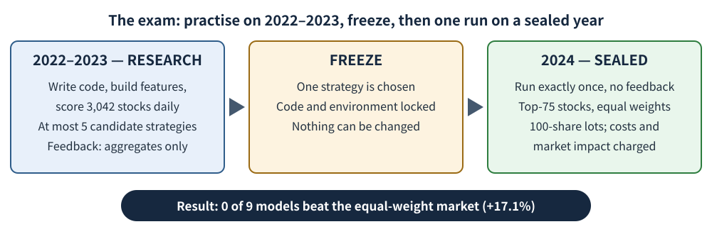
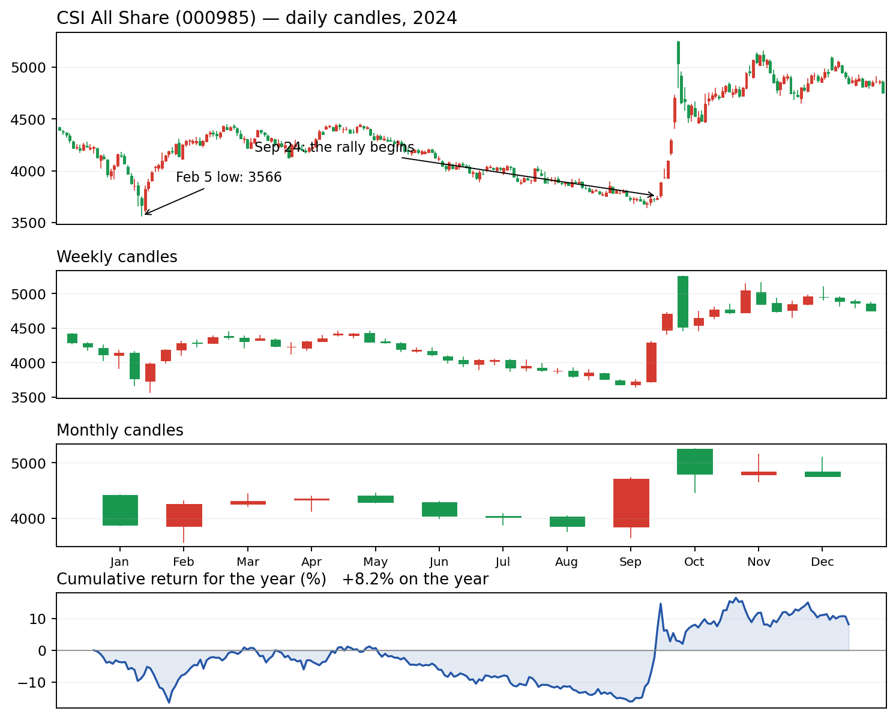
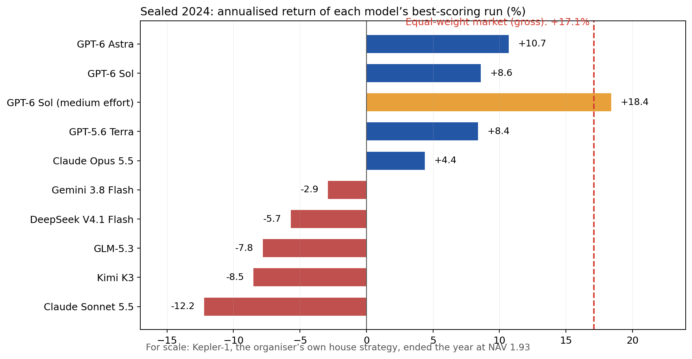

Every few weeks another headline announces that an AI model has beaten the stock market. Almost all of those claims rest on a backtest: the model is shown years of old prices and asked what it would have done. There is a basic problem with that exam. A large language model has read the past. Shown 2021's news, it may not be predicting anything — it may simply remember how the story ended.

A team at Navers Lab and Einsia.AI decided to set the exam properly. Their benchmark, Quant-Arena (Houde Qian and eleven colleagues, published on arXiv on 21 October 2026), hands a model the raw data of 3,042 Chinese A-share stocks and gives it the whole job of a quantitative researcher: write the code, invent the signals, test them, commit to one strategy — then face a year it has never been allowed to see, with no way to revise. Nine of the strongest models available took the test. In the sealed year, not one of them beat the laziest portfolio imaginable: the same amount of money in every single stock.

## An exam the models could not study for

Each model receives raw market data, down to Level-2 records of individual orders and trades. From that, it writes Python code that builds its own features — the numerical clues it thinks matter — and scores every one of the 3,042 stocks, every day.

The research period is 2022–2023. During those two years a run may test at most five candidate strategies, and the feedback it gets is deliberately thin: aggregate returns and signal statistics, the kind of summary a researcher sees, never the sealed future. Five tries is a hard cap, and it matters — try enough strategies on old data and one of them will look brilliant by pure luck.

Then one strategy is frozen. Code and environment are locked. The year 2024 is run exactly once, and no result flows back to the model. The referee is a cash account that follows strict rules: each day it holds the 75 stocks the strategy scores highest, buys them in 100-share lots (the standard board lot on Chinese exchanges), and charges realistic trading costs that depend on the order, plus market impact estimated from a simulated order book. Market impact is the friction every real trader knows: your own buying pushes the price up against you, your selling pushes it down. Cash sitting idle in the account earns exactly 0%.

<figure>

<figcaption>Figure 1 — The Quant-Arena protocol. Two years to experiment, at most five candidate strategies, then the code is locked and the sealed year runs exactly once.</figcaption>
</figure>

## First, the bar: what beating "the market" means

The thing the models had to beat needs explaining, because "the market" is not one number.

The benchmark in Quant-Arena is an equal-weight portfolio of all 3,042 stocks: the same amount of money in each one. No picking, no judgement — a tiny workshop in a provincial city counts exactly as much as the largest state bank. This is the laziest possible way to own a market, and it is the yardstick because it requires zero intelligence.

Most readers know a different kind of average. The big indices — the CSI 300, or the CSI All Share (index code 000985) — are capitalisation-weighted: a company's weight in the index is proportional to its size, so a giant bank moves the index and a small stock barely registers. Same market, two very different "averages". In 2024 the difference was large: the paper's equal-weight reference returned +17.1% before costs ("gross"), while the cap-weighted CSI All Share rose +8.2%. Small stocks, which equal weighting gives a full vote, had the stronger year — so the bar the models faced was a high one.

One measure will recur below: net asset value, or NAV. It is simply what one unit of money at the start is worth later. An account that begins the year at NAV 1.000 and ends at 1.170 has gained 17.0%.

## 2024: a crash, a grind, and a policy rocket

The sealed year was not a gentle one. It opened with a small-cap crash: in January and early February 2024, China's smaller stocks fell violently — the CSI All Share touched an intraday low of 3,566 on 5 February. The equal-weight yardstick, which by construction gives small stocks full weight, fell further: by 6 February it stood at 0.704, meaning a yuan invested on 1 January was worth 70 cents.

Spring brought a partial repair, then a long, grinding slide through the summer. By late September the CSI All Share was still below where it had started the year. Then, on 24 September, a package of policy announcements set off one of the most violent rallies in A-share history: from the close on 23 September to the end of the year, the index rose 27.1%, finishing 2024 up 8.2%. The equal-weight reference, after its rougher ride, finished at 1.170.

<figure>

<figcaption>Figure 2 — The CSI All Share index (000985), capitalisation-weighted, in 2024: daily, weekly and monthly candles plus the year's cumulative return (real data, source: Tencent quote history). Chinese market convention: red is up, green is down. This index gained 8.2% in 2024 — a different "average market" from the paper's equal-weight reference, which returned +17.1%.</figcaption>
</figure>

Any strategy frozen at the end of 2023 had to survive all three acts: the crash, the grind, and the rocket.

## The results: four above water, five below

The nine models — GPT-6 Astra, GPT-6 Sol, GPT-5.6 Terra, Claude Opus 5.5, Claude Sonnet 5.5, Gemini 3.8 Flash, DeepSeek V4.1 Flash, Kimi K3 and GLM-5.3 — each ran at several reasoning-effort levels, giving 38 iterative configurations (plus 38 one-shot runs without feedback). Returns below are annualised — for a one-year test, essentially the year's gain or loss expressed as a yearly rate — and are net of the trading costs the account actually paid.

No model's best-scoring run beat +17.1%. The highest total score went to GPT-6 Astra at extra-high effort: +10.7%, some 6.3 points behind the market, though with a maximum drawdown of only −6.8% (the maximum drawdown is the worst peak-to-trough fall along the way — the deepest hole the account was ever in). Then came Sol at +8.6%, Terra at +8.4% and Opus 5.5 at +4.4%. The other five lost money: Gemini 3.8 Flash −2.9%, DeepSeek V4.1 Flash −5.7%, GLM-5.3 −7.8%, Kimi K3 −8.5%, Claude Sonnet 5.5 −12.2%. Only four models ended the year with more money than they started: NAVs of 1.11, 1.09, 1.08 and 1.04, against 0.88 to 0.97 for the rest.

Across all 38 configurations, only 13 made any money at all. Exactly one beat the market: GPT-6 Sol at medium effort, +18.4%. But look at the price of that win — its maximum drawdown was −35.9%. At the worst moment of the year, a yuan in that account was worth about 64 cents before it recovered. Beating the market by 1.3 points while sitting through a 36% hole is a trade most investors would not accept.

<figure>

<figcaption>Figure 3 — Each bar is that model's best-scoring run in the sealed year 2024 (annualised return). The gold bar, GPT-6 Sol at medium effort, is the only run above the market line — and it survived a 35.9% maximum drawdown to get there. Model returns are net of trading costs; the equal-weight market line (+17.1%) is gross, before costs.</figcaption>
</figure>

## Why they fell short: real rankings, weak portfolios

The paper's own analysis is the most interesting part, because the models were not clueless. They could rank stocks — just not in a way that made money.

Consider RankIC, the scoreboard for ranking skill. It measures whether the model's ordering of stocks matches the order in which they actually perform next: 1.0 would be a perfect forecast of the ranking, 0 is coin-flipping. It is a grade for prediction, not a bank balance. And across the 38 runs, the correlation between RankIC and actual return was 0.09 — essentially none. GLM-5.3 ranked stocks well (RankIC 0.046) and lost 7.8%. Claude Opus 5.5 at medium effort ranked at chance level (−0.002) and made 4.4%.

Worse, the rankings bent the wrong way at the top. For six of the nine models, if you split their ranked stocks into ten groups, the second and third groups earned the most — 24 to 33 basis points a day (a basis point is one-hundredth of a percent) — while the top group, the model's very favourite stocks and the only ones the portfolio actually buys, earned less. The signal was real but faint, and it faded exactly where the money was placed.

Then there is exposure. Most strategies kept less than half their money in the market: in 35 of the 38 runs, average exposure was between 34% and 48%. Idle cash earns 0%, so a strategy that is 40% invested in a market that rises 17% has handed back most of the rise before stock-picking even starts — while still paying trading costs on every change it makes. Two more patterns complete the picture. More reasoning effort did not reliably help: for six of nine models, the best effort level was not the highest one. And iteration — the feedback loop — raised every model's total score but raised actual returns for only four of the nine. Part of what feedback teaches is how 2022–2023 in particular behaved, which is overfitting in plain words: fitting history's accidents ever more tightly, until the strategy has memorised the rehearsal and fails the performance. Finally, the styles converged: eight of nine models tilted toward small-cap stocks, seven toward value (shares cheap relative to their book value), and most toward low volatility. A shared textbook style, held by everyone, separates nobody.

## The winner won by hiding

The best total score deserves a closer look, because how Astra won is the story in miniature.

Astra's early candidates lost money in both research years — down 12.2% in 2022 and 13.6% in 2023. In its fourth and fifth candidates, the model added a market-state switch. Each day it checks the whole universe of stocks: if the median stock's 5-day return and its 20-day return are both positive, the strategy holds shares; otherwise it holds cash. A simple rule: only play when the whole market is rising.

In sealed 2024, that switch was worth more than any stock-picking. While the equal-weight market crashed to 0.704 on 6 February, Astra's account was still worth exactly 1.000 — it had not bought anything. It made its first purchase on 28 February. Over January and February its drawdown was −1.7%, against the market's −29.6%.

Safety has a price, and Astra paid it. The strategy held cash on 75% of trading days. From the February low it captured only 16% of the market's rebound (Terra, which stayed invested, captured 73%). And 12.5% of its entire year's gain arrived in just five sessions, 24–30 September, when it happened to be invested for the policy rally. It finished at NAV 1.107 against the market's 1.170: a year spent mostly in hiding, rescued from mediocrity by one good week. That is risk control, and it is genuinely valuable — but it is not stock-picking genius.

## The house strategy, and what it proves

The same leaderboard carries one more entry, and it has to be described honestly: Kepler-1, a proprietary strategy from Einsia.AI — the team that built the benchmark. It scored 77.56 against the best model's 51.29, and it ended 2024 at NAV 1.93, against the market's 1.17. Disclosure made, two facts stand. Its account was computed by the same evaluator under the same rules. And its ranking accuracy was lower than Astra's — RankIC 0.085 against 0.101 — while its Sharpe ratio (return earned per unit of bumpiness along the way) was 2.98 against the best model's 1.89.

Kepler-1 matters for two reasons. First, it proves the test can be beaten: the models did not fail because the bar was set impossibly high. Second, it locates the gap. Kepler-1 predicted slightly worse than Astra and earned vastly more. The difference is not foresight; it is conversion — how much money you put behind a faint signal, how fully you stay invested, how you control costs. That unglamorous machinery is where the models are weak.

## Why the seal is the whole point

Sceptics might ask whether the sealed design is overkill. A study published in August 2026 by the Artul.ai Research Group shows why it is not. That team scored 165,182 earnings-call transcripts with a language model and tested some 1,600 hypotheses about what predicts returns. Their best signal passed every backtest control they could devise — split-half validation, placebo questions, pre-registration. Then they froze it and watched for twelve months: the frozen forward test lost a median of 12.4% against the index. The autopsy found the cause. Given only a stock's ticker symbol and a date — no transcript, no document at all — the model could still "predict" 66 to 72% of historical winners. It recognised the period and remembered the outcomes. Any backtest on public history is an exam for which the model may hold the answer key.

Quant-Arena's defences answer that failure one by one: a sealed year the model cannot have memorised, a cap of five candidates so it cannot buy hundreds of lottery tickets, and trading costs switched on, because paper profits have a habit of evaporating in real execution.

## The fine print, and the verdict

The caveats, plainly. This is a preprint, not peer-reviewed. It tests one sealed year in one market, and 2024 had a very particular shape — a crash and a policy rally — so a different year might rank the models differently. The +17.1% market line is gross of costs while the strategies paid costs, so the bar is tilted slightly against the models; a real equal-weight portfolio would have netted less than 17.1%. Each configuration ran only once, so luck is not averaged out. Part of the total score rests on an unpublished formula. And Kepler-1 is the organiser's own strategy — on that line of the leaderboard, they mark their own homework.

None of that overturns the central finding, because the finding is modest and the design is the cleanest yet applied to the question. This is the first widely visible test of whether a language model can do the entire quant researcher's loop — idea, code, test, freeze, and survive unseen data — rather than merely talk about stocks. The answer so far: today's frontier models find faint, genuine signals, and cannot yet turn them into portfolios. The best of them won by refusing to play three days out of four. The bottleneck is not prediction; it is everything that comes after prediction.

So here is a rule of thumb for the next headline. When a fund, a startup, or a screenshot claims "our AI returned X%", ask a single question: was the strategy frozen before the test period began, and was that period kept sealed? If not, you are not looking at evidence. You are looking at advertising.
