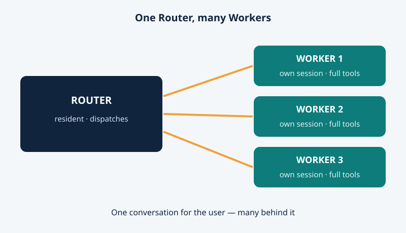
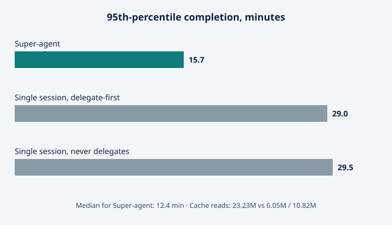

On October 31, 2026, DeepSeek's Harness team published a design essay with an unfashionable claim: the next bottleneck in AI coding is not the model. It is you. *Super-agent Design Exploration* argues that one task is limited by the model, but many tasks at once are limited by human attention — a person can usually keep up with only three to five active sessions. With it came a research prototype, dsh-superagent-prototype, under the MIT licence: not a new model, but a new way to organise the models we already have.

## The bottleneck is you

Each session today is its own little world, blind to the others; run four or five at once and programming becomes switchboard operation. DeepSeek's answer: stop asking the human to be the switchboard.

## A reception desk and separate workbenches

The design has two layers. The Router is one session that stays awake, takes requests from every channel, and keeps what is shared across tasks. It only talks and dispatches — no heavy tools needed — and a lighter, faster model is often enough, because coordinating is simpler than coding.

Each Worker is a separate session with its own context and directory, given the full tools and usually the strongest model, because the Worker determines code quality. A bug hunt, a review reply, and a feature change can thus run at once, each in its own space. When a Worker finishes, it reports to the Router, which answers the human for it: one conversation for the user, many behind it.

<figure>

<figcaption>Figure 1 — The Router talks to people and dispatches; each Worker owns one job, its own session, and its own directory, and reports back through the Router.</figcaption>
</figure>

## It listens before it speaks

Super-agent is driven by events — Triggers: a chat message, a calendar reminder, a review comment, a test result. Noisy group chats pass a two-level filter: a Fast Path admits events by source, group, and allowlist, and an LLM Slow Path judges survivors against a policy.

Follow-ups skip the queue: events in one pull request or chat topic form a Thread, and its Worker subscribes, so later messages go straight to it — and if two Workers touch one pull request, both see new events and can spot conflicts.

Memory is thrifty too: the context window works like a cache — likely-needed facts inlined, the rest left as pointers, every object carrying the IDs of related objects, so the model follows a chain of recalls instead of reloading all history.

Then the proactive part. In DeepSeek's internal user group, the agent was set to silently reproduce and fix reported bugs, speaking up only once an issue was confirmed and a simple fix found. While members were still discussing a bug where tildes rendered as strikethrough, it had already opened a fix pull request. Long commands run asynchronously, a Watchdog session watches for stalled Workers, and the loop can run in stateless cloud containers while each machine runs only a lightweight daemon — so a laptop with local credentials can be a Worker machine without handing its session to a server.

## The numbers, honestly labelled

The team tested this on a synthetic stream: about 300 messages, roughly 20 real work requests, each setup run five times. Coding was replaced by a time-consuming tool, and timings were scaled to a quarter — so the test measures scheduling, not code quality, and the authors call the results preliminary.

<figure>

<figcaption>Figure 2 — On the synthetic workload, Super-agent finished 95% of tasks within 15.7 minutes, against 29.0 and 29.5 minutes for single-session setups — but it read far more cached tokens (23.23 million versus 6.05 and 10.82 million).</figcaption>
</figure>

Half the tasks finished within 12.4 minutes, 95% within 15.7, against 29.5 minutes at the 95th percentile for a single session that never delegated; a delegate-first session still tailed to 29.0, because in one run it judged a job "small" and did it itself. The catch is cost: 23.23 million cached tokens per run, against 6.05 and 10.82 million. Under load the Router scales well: as events rose from about 1 to about 40 per minute, batched decisions cut inference time per decision from 6.4 to 1.6 seconds.

## What actually shipped — and what to watch

Here the story narrows. The public prototype is a proactive coding agent for a single GitHub repository, packaged as a bundle for DeepSeek Harness, the team's open-source agent runtime. It listens to GitHub and optionally Feishu; an allowed user's request becomes a work item with its own session and directory, and the result returns to the original conversation, for example as a pull request. A dashboard lists only items needing a human.

But the README is clear: research code for reference only, not an official DeepSeek product, not production-ready. Much of it was written by coding agents, it differs from the internal version, and some essay designs are unimplemented. The internal instance — quietly fixing bugs in DeepSeek's own development — is more capable than what was published.

Reports note Workers run commands without approval, as the operator's operating-system user, and Harness is experimental preview software: review plugins and commands, run with minimal privileges. The essay's open problems agree: Router scaling, long-term memory, hidden-session visibility, and prompt injection from cloud to local machine.

## Why it matters anyway

No new model was announced on October 31, and that is the point. The frontier argument has been about bigger, smarter models; Super-agent says the next gains come from organisation — treating human attention as the scarce resource, spent on decisions, not session management. Paid tools sell a model and a chat window; DeepSeek published, free, a pattern for turning any model into a round-the-clock team with a manager. Rivals can copy it, but they cannot un-publish the idea that the babysitting is optional.

The sharper edge: an agent that silently fixes bugs is wonderful until it silently does something you would not approve. Allowlists, filters, and a dashboard are the design's answer; whether they are enough control for a system built to need as little attention as possible is a question every team installing it must answer.

If your coding agent could quietly fix bugs before you even noticed them, how much unsupervised action would you let it take before it had to ask?

Sources: https://agentspulse.github.io/tutorials/deepseek-super-agent-architecture/ , https://www.aiaffairs.com/technology/deepseek-harness-super-agent-coding-prototype/ , https://chinamodelapi.com/news/deepseek-superagent-open-source , https://cointelegraph.com/news/deepseek-developing-ai-agent-requiring-less-human-input-report
