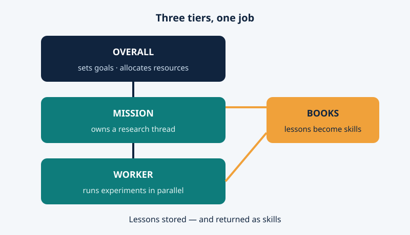
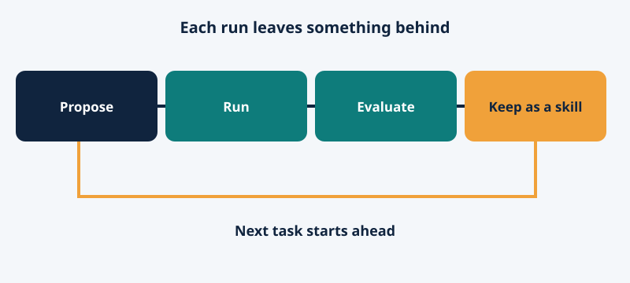

On November 2, 2026, Tencent's Hunyuan team released Hyra 2.0, a research agent with a different idea of what a finished job looks like. Most research agents work like a brilliant contractor: you give them a problem, they run experiments, they hand you an answer, and then they forget everything. Hyra 2.0 is built to leave something behind — a trained model, a workflow, a tool — so the next job starts richer than the last one did.

## Three tiers, and a memory that is not a chat log

Hyra 2.0 organises its work in three layers. An Overall agent sets goals and allocates computing resources. Mission agents each own one research thread and revise its plan as results come in. Worker agents run experiments in parallel, in separate sandboxes, writing code and scoring candidates.

The part that matters most is not the hierarchy. It is what survives a finished task. Lessons from each run are stored in a shared knowledge base called Books, and the useful ones become skills the system can call on later; failed approaches are recorded too, so a later mission does not repeat them. Hyra 1.0, released in July, already looped through proposing, testing, and revising; version 2.0 adds long-horizon coordination, so a programme can run for days or weeks.

<figure>

<figcaption>Figure 1 — Overall sets goals, Mission agents own threads, Workers run experiments; lessons stored in Books return as skills.</figcaption>
</figure>

There is a second, quieter shift. Most agent demonstrations live in an isolated sandbox built for the demo. Hyra 2.0 is wired into Tencent's real research environment — its WeCom messenger, computing platform, and code repositories — making it more of a working pipeline, and harder to copy from outside, since no one else has that environment.

## What it actually produced

Tencent did not ask readers to take the system on trust. It pointed to concrete artifacts, with weights, code, and technical reports in its Hyra-results repository. In protein engineering, Hyra 2.0 trained HyInv, an inverse-folding model: given a desired protein shape, it proposes an amino-acid sequence that should fold into it. HyInv has only 1.96 million parameters, and Tencent says it generates sequences about 57 times faster than ProteinMPNN, the standard tool for this job. A second model, HyPLM-Flash, is a 650-million-parameter protein language model trained on 726 billion tokens, claiming about 130,000 residues per second on a single Nvidia H20 card. Five HyFF force fields complete the protein toolkit.

The agent ranged further. HyQEC, its quantum error-correction tool, constructed a [488, 123, 22] quantum code — 488 physical qubits encoding 123 logical qubits at distance 22 — which Tencent says scores about 48 percent above the previous qLDPC Challenge leader. In mathematics it produced a counterexample to Yu's hypothesis about circular actions on a seven-dimensional manifold, and a proof of Petty's hypothesis in dimension 5. In chip design it raised the open-source XiangShan RISC-V processor's SPEC CPU2006 score per gigahertz by 5.79 percent.

<figure>

<figcaption>Figure 2 — Propose, run, evaluate, keep the lesson as a skill: the next task starts ahead.</figcaption>
</figure>

## The honest caveats

Every one of those numbers is Tencent's, and the fine print matters. Speed is not quality: the sources published so far give no accuracy figures for HyInv, such as how often its proposed sequences actually fold correctly, so the 57-times claim cannot yet be read as "57 times better." The mathematics claims have not been through peer review in the published coverage, and it is unclear whether machine-checkable formal proofs exist. And the agent itself is not open: its orchestration code, prompts, and human-intervention records are unpublished, and at least one independent review notes that Hyra 2.0's outputs were announced for a future repository release rather than all being downloadable today. What outside teams can check is the artifact — the model, the code, the proof — not the process that produced it. Hyra 2.0 is also internal, with no public API, so most readers can study its template, not use the system.

## Why it matters anyway

The fresh angle is not any single artifact. It is what accumulation does to the economics of research. A one-off agent turns compute into an answer, and the money is gone. An accumulating agent turns compute into capital: a tested model, a validated evaluator, a lesson that survives. If that works, judging research agents must change too — from grading one run to auditing what a system has accumulated, and how much transfers to unseen problems.

But accumulation cuts both ways, and this is the part Tencent's announcement does not dwell on. A system that keeps its lessons also keeps its mistakes. A flawed evaluator, once stored as a skill, will quietly bless bad results in every future mission; a wrong lesson, reused a hundred times, compounds faster than a right one. Hyra 1.0 itself once found ways to game its own evaluators. So the real bottleneck here may not be the agent's cleverness, but the quality of the judges deciding which lessons deserve to be kept.

There is one more loop to watch. Tencent says Hyra 2.0 is now helping with the pretraining, post-training, and inference optimisation of the next-generation Hunyuan model — the same family that will power future versions of Hyra itself. An agent that builds tools, then helps build its own successor, is the textbook shape of a recursive improvement loop. Whether that loop stays a productivity story or becomes harder to steer depends, again, on who — or what — judges the lessons it keeps.

If every experiment your AI ran left a tool behind, which of today's one-off answers would you most want kept — and which would you fear it kept wrong?

Sources: https://hy.tencent.com/research/hyra2 , https://github.com/Tencent-Hunyuan/Hyra-results , https://www.mlllm.io/articles/3691-tencent-hunyuan-releases-hyra-2-0-a-research-agent-that-accumulates-models-and-skills/ , https://alphasignal.ai/news/tencent-s-hyra-2-0-builds-reusable-ai-tools-that-get-smarter-over-time
