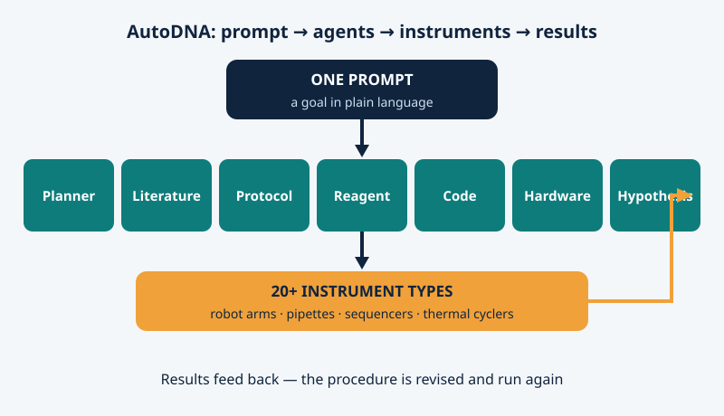

On November 4, 2026, *Nature* [published AutoDNA](https://www.nature.com/articles/s41586-026-11228-6), a laboratory at Shanghai Jiao Tong University where a human types one sentence of plain language — and a team of AI agents designs the experiment, writes the instrument code, runs more than twenty kinds of machines, checks the results and fixes the procedure when something drifts. Human hands come back only to refill reagents and swap labware, as *Nature*'s [news report](https://www.nature.com/articles/d41586-026-03552-8) puts it.

## Built around agents, not retrofitted with them

Laboratories have had robots for decades. What they automated was hands: pipetting, heating, moving plates. The thinking stayed with people. In most existing systems, as senior author Haibo Chen told *Nature*, human experts still configure the instruments, and AI handles just one part of the process.

AutoDNA, led by Mingyu Wu with Chen as senior author, was designed the other way round. Models, experiments and instruments were built together, so the agents can reason about a chemical goal and a hardware constraint in the same breath.

## Seven specialists, twenty-odd instruments

The work is split among specialised agents. A planner breaks the goal into steps. A literature agent searches what is known; a protocol agent drafts the procedure; a reagent agent checks that the needed chemicals actually exist; a code agent writes the control programs; a hardware agent schedules the machines and can swap in an equivalent device when one is busy; a hypothesis agent proposes improvements when results miss their target. Then the loop turns again: design, experiment, optimise.

Below them sits the physical lab: robotic arms, pipettes, thermal cyclers, heaters, magnetic racks and nanopore sequencers — more than twenty instrument types in all. The platform can also serve several users at once, rescheduling steps when their jobs collide.

<figure>

<figcaption>Figure 1 — One prompt, seven specialised agents, twenty-odd instruments — and results fed back to revise the procedure.</figcaption>
</figure>

## Three results you can check

**A sentence stored in DNA.** The team asked AutoDNA to encode the quote "Intelligence is the ability to adapt to change" into DNA. The agents designed the encoding, synthesised 78 DNA strands, stored them, amplified and sequenced them back, and decoded the reads. The storage run took more than 11,000 instrument operations across roughly 200 hours, and the original text came back exactly, character for character.

**Expert-level synthesis, found by trial.** In enzymatic DNA synthesis, the agents adjusted reaction times, reagent concentrations and wash steps round after round. The stepwise yield reached 97.8%, matching what published expert-optimised work had achieved. Running several protocols at once, with the agents rescheduling around each other, finished 3.2 times faster than running them one after another.

**A known cancer mutation, caught.** Given a pre-processed colorectal-cancer sample, AutoDNA designed and synthesised its own detection primers and correctly identified the KRAS G13D mutation the sample was known to carry.

One small detail says a lot. During a detection experiment, the agents decided on their own to cap the reaction tubes during incubation, so the liquid would not evaporate. Nobody had told them to. It is the kind of step experienced researchers do without thinking, and beginners leave out of written protocols.

## What was actually automated here

Pipetting was never the hard part. The scarce resource in a lab is expert judgement: knowing how to design the procedure, noticing when a result smells wrong, deciding what to try next. That is the layer AutoDNA automates. If it travels beyond one lab, an experiment stops being something only a specialist team can perform and becomes something closer to a service you request in plain language. The authors call the design a blueprint for exactly that.

## Read it with clear eyes

The caveats are real. These were controlled validation tasks, not a discovery: the KRAS mutation was already known, and storing one short sentence proves a working cycle, not a practical archive. People still replenish reagents and labware and service the hardware, and device faults during these runs sometimes needed human hands after all. The system exists in exactly one laboratory and works in nucleic-acid chemistry. And the work itself is not brand new: a preprint has been public since July 2025 (arXiv:2507.02379). The news this week is that it has now passed peer review in *Nature*. The code and data are open, on GitHub and Zenodo, so others can test how far it generalises.

When the machine can design the experiment as well as run it, what is left that only the human scientist can do — choosing the question, or knowing when the machine's answer is wrong?
