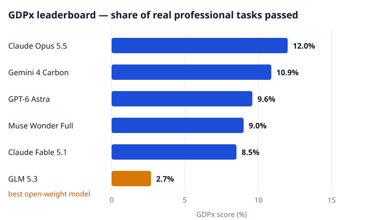

On November 2, 2026, the research firm SemiAnalysis published [GDPx](https://gdpx.semianalysis.com), a benchmark built around an uncomfortable idea: stop asking AI models exam questions, and hand them real professional work instead — a private-equity deal to analyse, a contract to redline, a chip to design — with up to eight hours to finish and practitioners' standards to meet. The best score in the world is 12.0%.

## Work, not questions

GDPx v1.0 holds 206 tasks across 11 equally weighted domains: chip design, cybersecurity, biology, finance, legal, quant trading, recursive self-improvement, hardware design, materials science, alignment and software engineering. Fourteen specialist firms built the tasks inside simulated workplaces. The finance set, for example, recreates a real $880 million acquisition spread across roughly 4,000 anonymised files, and the model has to find its way through them like an analyst would. Each model gets three attempts per task; the score is its first-try pass rate, averaged. Most domains grade pass or fail, a few use continuous scores.

GDPx follows OpenAI's GDPval, released in September 2025, which graded finished documents but never let a model work interactively. The GDPx authors — Max Kan, Andrew Megalaa and Dylan Patel — argue the difference is the whole point: real work means opening the files, using the tools, and recovering from your own mistakes over hours, not producing one polished answer.

## The board

<figure>

<figcaption>Figure 1 — GDPx scores for the top five models, plus the best open-weight model, GLM 5.3. Source: the GDPx leaderboard, SemiAnalysis.</figcaption>
</figure>

Claude Opus 5.5 leads at 12.0% — about one task in eight brought to an acceptable finish. Gemini 4 Carbon is second at 10.9%, GPT-6 Astra third at 9.6%, Meta's Muse Wonder Full fourth at 9.0%. The best open-weight model, Z.ai's GLM 5.3, reaches 2.7%. In finance and legal the floor drops out entirely: under strict pass-or-fail grading, basically every model scores zero, so SemiAnalysis reports partial credit in those two domains instead. On one public legal task, none of 20 attempts produced a contract redline a lawyer could actually use.

## Money doesn't fix it

The cost column tells its own story. Opus 5.5's runs average $51.41 per task. The most expensive model on the board, Claude Fable 5.1 at $67.16 per task, scores lower — 8.5%. Gemini 4 Carbon takes second place at roughly a third of the leader's price. And DeepSeek 4.1 Flash, at $0.94 per task — about one fifty-fifth of what Opus spends — still manages 5.4%, close to half the top score. Paying more does buy stronger agents. It does not buy proportionally stronger ones.

Readers here have met the quant version of this story. In the [Quant-Arena study](https://opensilabs.github.io/posts/2026-10-31-quant-arena) we covered recently, nine frontier models wrote trading strategies for 3,042 A-shares and none of them beat simply holding the whole market. Quant trading is one of GDPx's 11 domains, and Opus 5.5 actually won it — yet SemiAnalysis reports that in most graded quant runs the models still underperformed a simple reference strategy. One more domain deserves a pause: recursive self-improvement, the industry's bet that AI will soon speed up its own development, sits on the same board as contract law, and no model is anywhere near mastering either.

## Read it with clear eyes

GDPx is a measuring stick, not a new model or method — and this stick has owners. It is a paid SemiAnalysis product; most of the partner-built tasks are private and unaudited, and no outside group has replicated the numbers yet. Part of the gap is also the labs' own doing: the safety classifiers on Opus 5.5 and GPT-6 Astra refuse or cut short work in the cybersecurity, biology and alignment domains, which drags their averages down, and SemiAnalysis itself publishes an alternate ranking with those three domains removed. Finally, guard the headline against itself. Twelve percent is a pass rate on 206 particular tasks picked for their economic value. It is not a measurement of all jobs everywhere, and finance and legal sitting at zero says as much about how unforgiving real deliverables are as it does about the models.

For years, the field mostly measured what models know. GDPx measures what they can finish — and on the first serious attempt at that measurement, the best machine in the world leaves seven of every eight jobs undone. How fast that number climbs from here is the argument that now matters.
