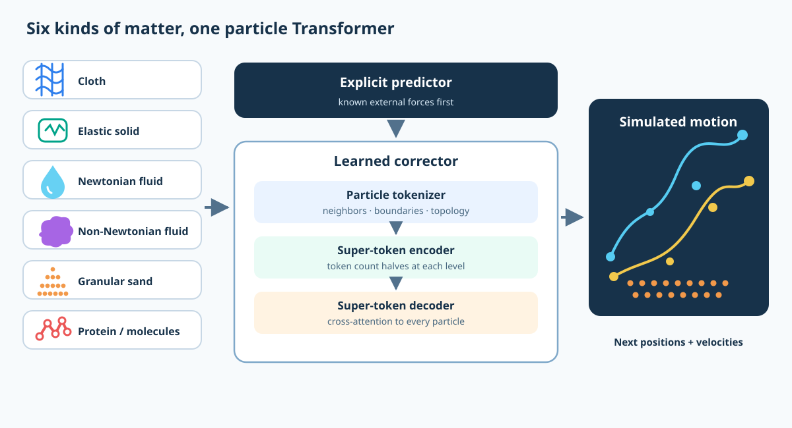

A dune, a shirt, a splash, a rubber block and a protein do not look like the same computing problem. WorldParticle treats them as if they were. Each object becomes thousands or millions of three-dimensional particles, carrying position, velocity and physical properties, and a Transformer predicts how those particles move, one step at a time.

The work comes from Caoliwen Wang, Minghao Guo, Peter Yichen Chen, Wojciech Matusik and colleagues at MIT, the University of British Columbia and partner institutions. The [paper](https://arxiv.org/abs/2605.15305) was first posted in May 2026. Its publication in *ACM Transactions on Graphics*, [MIT News coverage](https://news.mit.edu/2026/single-ai-model-simulates-many-substances-behavior-1109) in November and scheduled presentation at SIGGRAPH Asia in December are the new milestones — not a new November paper.

## Simulation has been a patchwork

A fluid may be represented on a grid or by smoothed particles. Cloth and elastic solids often use meshes and finite elements. Sand needs granular mechanics; proteins need atomistic potentials. Each choice brings its own equations, approximations and software. Modern engines can package several solvers together, but each phenomenon still keeps a dedicated engine underneath. Coupling two kinds of matter means making those engines cooperate.

WorldParticle starts with a shared language. In a Lagrangian representation, the calculation follows pieces of material as they move, rather than asking what passes through fixed points in space. Mesh vertices, fluid samples and atoms can all be described as particles. That solves only the representation problem. The harder part — how the particles interact — is learned.

## Predict the easy part, learn the rest

Chen describes WorldParticle as having “a similar architecture to ChatGPT,” except that it predicts particle motion rather than the next word. At each step, an explicit predictor first applies known external forces, such as gravity or a push. This produces a sensible provisional state, but it cannot account for collisions, pressure, friction or bonds between particles.

A learned corrector then predicts the missing position and velocity changes in three stages. A particle tokenizer examines local relationships: nearby particles, contact with boundaries, and topology — the fixed connections that matter in cloth and elastic materials. A super-token encoder groups particle tokens into larger units, halving their number at each level while alternating token merging with attention. Distant parts of a system can therefore exchange information without every particle attending to every other particle. Finally, a super-token decoder uses cross-attention to turn that compressed view back into a correction for each particle.

The architecture has about 157 million parameters and stays fixed across all six categories. Only the training data changes.

<figure>

<figcaption>Figure 1 — Six kinds of particle dynamics enter one fixed architecture: an explicit predictor handles known forces, and a learned corrector uses particle tokens and super-tokens to calculate interactions.</figcaption>
</figure>

## Sand settles; proteins take much larger steps

For each category, the team trained a parameter set on trajectories from established solvers. Held-out tests changed materials, shapes, boundaries, starting states and forces. MIT News summarises the results as higher accuracy than numerical simulation methods across the six phenomena. The qualitative failures are easier to picture. A tiger-shaped pile of granular material, a geometry absent from training, collapses and spreads in a plausible way in WorldParticle; some neural baselines leave grains hanging in the air.

The protein result gives the clearest speed figure. WorldParticle predicted side-chain rotation with 50-femtosecond steps, compared with the 0.5-femtosecond steps used by the traditional simulation in the paper. Guo describes the resulting protein modelling as about 100 times faster. That figure belongs to this protein setting, not to every material.

The same design also supported three uses beyond forward simulation: applying new forces interactively, recovering a friction coefficient through differentiable rollouts in an inverse-design test, and predicting particle trajectories learned from real-world manipulation data.

## Why a common simulator matters

A shared simulator would do more than save programming effort. If cloth, fluid and soft solids speak the same computational language, researchers can couple them, test a design interactively, or ask how a parameter should change to reach a target. WorldParticle also differs from video world models in an important way: it predicts an explicit physical state — positions and velocities — that can be inspected and reused, not just plausible-looking frames.

That is why Chen speaks of a “GPT moment for simulation” and the team calls this a first step toward a foundation model for physics. The ambition is a simulator that works out of the box across scenarios, instead of a fresh solver for each phenomenon.

## The limits are part of the result

The unity is architectural, not yet a single trained model. The paper states plainly that the researchers currently train one parameter set per dynamics category; shared weights across all six remain future work. It also concedes some loss of per-phenomenon accuracy compared with specialised classical solvers. WorldParticle learns from trajectories produced by established solvers, so it can inherit their assumptions and errors. It does not derive physics from raw observation alone.

The accuracy and speed results are the team’s own, with no independent replication yet. Long rollouts remain a general weakness of autoregressive simulators because small errors compound; the prediction-correction design reduced that problem in these tests, but did not abolish it. Memory is another constraint: despite the particle language being able to describe millions of points, the current implementation supports roughly 50,000 particles on one 80GB A100 because its first layer attends at full particle resolution.

WorldParticle has not replaced the specialist toolbox. It has shown that one carefully structured architecture can learn several kinds of matter through the same interface — and that may be the more consequential step.

If changing the training data is eventually enough to teach one simulator a new kind of matter, what should count as understanding physics: deriving the governing equation, or predicting matter well enough to design with the answer?
