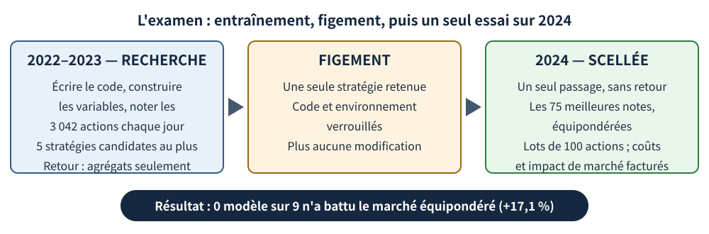
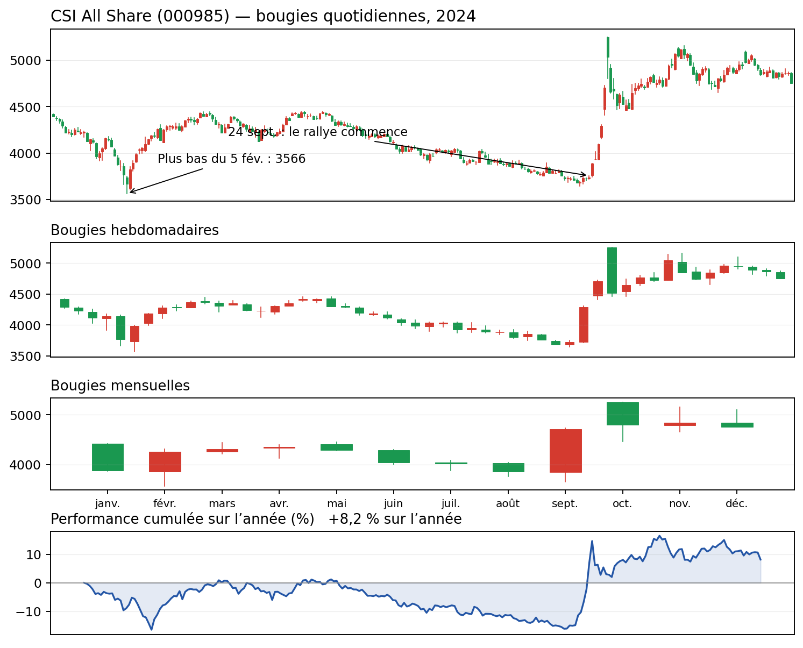
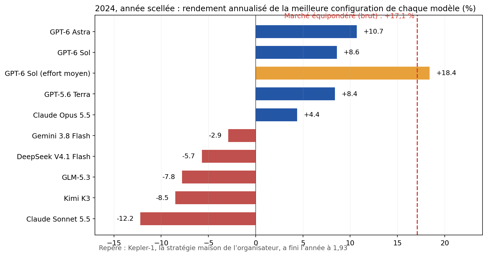

Toutes les quelques semaines, un titre annonce qu'un modèle d'IA a battu le marché boursier. Presque toutes ces affirmations reposent sur un backtest : on montre au modèle des années de cours passés et on lui demande ce qu'il aurait fait. Cet examen a un problème de fond. Un grand modèle de langage a lu le passé. Devant l'actualité de 2021, il ne prédit peut-être rien — il se souvient de la fin de l'histoire.

Une équipe de Navers Lab et d'Einsia.AI a décidé de faire passer l'examen dans les règles. Leur banc d'essai, Quant-Arena (Houde Qian et onze collègues, publié sur arXiv le 21 octobre 2026), confie à un modèle les données brutes de 3 042 actions chinoises de type A et lui donne le travail complet d'un chercheur quantitatif : écrire le code, inventer les signaux, les tester, s'engager sur une stratégie — puis affronter une année qu'il n'a jamais vue, sans retour possible. Neuf des modèles les plus puissants du moment ont passé le test. Sur l'année scellée, aucun n'a battu le portefeuille le plus paresseux qui soit : le même montant d'argent dans chaque action.

## Un examen impossible à bachoter

Chaque modèle reçoit les données de marché brutes, jusqu'aux enregistrements de niveau 2 des ordres et transactions. Il écrit alors du code Python qui construit ses propres variables — les indices numériques qu'il juge pertinents — et note les 3 042 actions, chaque jour.

La période de recherche couvre 2022 et 2023. Pendant ces deux années, une exécution peut tester au maximum cinq stratégies candidates, et le retour qu'elle reçoit est maigre : des rendements agrégés et des statistiques sur les signaux, jamais l'avenir scellé. Ce plafond compte : à force d'essayer des stratégies sur des données anciennes, l'une finit toujours par sembler brillante par pur hasard.

Ensuite, une stratégie est figée. Le code et l'environnement sont verrouillés. L'année 2024 est exécutée exactement une fois, et aucun résultat ne revient vers le modèle. L'arbitre est un compte en espèces aux règles strictes : chaque jour, il détient les 75 actions les mieux notées, par lots de 100 actions (le lot standard en Chine), et facture des coûts réalistes, fonction de l'ordre, plus un impact de marché estimé sur un carnet d'ordres simulé. L'impact de marché, c'est la friction que tout opérateur connaît : vos achats font monter le prix contre vous, vos ventes le font baisser. Les liquidités inactives rapportent exactement 0 %.

<figure>

<figcaption>Figure 1 — Le protocole Quant-Arena : deux ans d'expérimentation, cinq stratégies candidates au maximum, puis le code est verrouillé et l'année scellée n'est exécutée qu'une seule fois.</figcaption>
</figure>

## D'abord, la barre : que signifie « battre le marché »

Ce que les modèles devaient battre mérite une explication, parce que « le marché » n'est pas un nombre unique.

La référence de Quant-Arena est un portefeuille équipondéré des 3 042 actions : le même montant dans chacune. Aucun choix, aucun jugement — un petit atelier d'une ville de province compte exactement autant que la plus grande banque d'État. C'est la manière la plus paresseuse de détenir un marché — et c'est pour cela qu'elle sert de référence : elle ne demande aucune intelligence.

La plupart des lecteurs connaissent un autre type de moyenne : les grands indices — le CSI 300, ou le CSI All Share (code 000985) — sont pondérés par la capitalisation. Le poids d'une entreprise y est proportionnel à sa taille : une banque géante fait bouger l'indice, une petite valeur pèse à peine. Même marché, deux « moyennes » très différentes. En 2024, l'écart était considérable : la référence équipondérée de l'article a rapporté +17,1 % avant coûts (« en brut »), tandis que le CSI All Share a progressé de +8,2 %. Les petites capitalisations, auxquelles l'équipondération donne une voix pleine, ont connu la plus forte année : la barre était donc haute.

Une mesure reviendra souvent : la valeur liquidative (NAV). C'est ce que vaut, plus tard, une unité d'argent au départ : un compte qui commence à 1,000 et termine à 1,170 a gagné 17,0 %.

## 2024 : un krach, une longue glissade, puis une fusée politique

L'année scellée n'a pas été tendre. Elle s'est ouverte sur un krach des petites capitalisations : en janvier–février 2024, les petites valeurs chinoises ont chuté violemment — le CSI All Share a touché un plus bas intrajournalier de 3 566 le 5 février. La référence équipondérée, qui donne par construction un poids plein aux petites valeurs, est tombée plus bas encore : le 6 février, elle valait 0,704 — un yuan investi le 1er janvier n'en valait plus que 0,70.

Le printemps a apporté une réparation partielle, puis une longue glissade pendant tout l'été. Fin septembre, le CSI All Share était encore sous son niveau de début d'année. Puis, le 24 septembre, une série d'annonces de politique économique a déclenché l'un des rallyes les plus violents de l'histoire des actions A : de la clôture du 23 septembre à la fin de l'année, l'indice a bondi de 27,1 %, terminant 2024 à +8,2 %. La référence équipondérée, après un parcours plus rude, a fini à 1,170.

<figure>

<figcaption>Figure 2 — L'indice CSI All Share (000985), pondéré par la capitalisation, en 2024 : chandeliers quotidiens, hebdomadaires et mensuels, et performance cumulée de l'année (données réelles, source : historique de cotations Tencent). Convention chinoise : le rouge monte, le vert baisse. Cet indice a gagné 8,2 % en 2024 — une « moyenne du marché » différente de la référence équipondérée de l'article scientifique, à +17,1 %.</figcaption>
</figure>

Toute stratégie figée fin 2023 devait survivre aux trois actes : le krach, la glissade et la fusée.

## Les résultats : quatre au-dessus de l'eau, cinq en dessous

Les neuf modèles — GPT-6 Astra, GPT-6 Sol, GPT-5.6 Terra, Claude Opus 5.5, Claude Sonnet 5.5, Gemini 3.8 Flash, DeepSeek V4.1 Flash, Kimi K3 et GLM-5.3 — ont chacun tourné à plusieurs niveaux d'effort de raisonnement, soit 38 configurations itératives (plus 38 exécutions uniques, sans retour). Les rendements ci-dessous sont annualisés — pour un test d'un an, c'est à peu près le gain ou la perte de l'année en taux annuel — et nets des coûts réellement payés.

Aucune meilleure exécution n'a battu les +17,1 %. Le meilleur score total est revenu à GPT-6 Astra, en effort maximal : +10,7 %, soit 6,3 points de retard sur le marché, mais avec une baisse maximale de seulement −6,8 % (la baisse maximale est la pire chute du sommet au creux en cours de route — le trou le plus profond du compte). Venaient ensuite Sol à +8,6 %, Terra à +8,4 % et Opus 5.5 à +4,4 %. Les cinq autres ont perdu de l'argent : Gemini 3.8 Flash −2,9 %, DeepSeek V4.1 Flash −5,7 %, GLM-5.3 −7,8 %, Kimi K3 −8,5 %, Claude Sonnet 5.5 −12,2 %. Quatre modèles seulement ont terminé avec plus d'argent qu'au départ : des valeurs liquidatives de 1,11, 1,09, 1,08 et 1,04, contre 0,88 à 0,97 pour les autres.

Sur l'ensemble des 38 configurations, 13 seulement ont gagné de l'argent. Une seule a battu le marché : GPT-6 Sol en effort moyen, à +18,4 %. Mais regardez le prix de cette victoire : sa baisse maximale a atteint −35,9 %. Au pire moment, un yuan placé dans ce compte valait environ 64 centimes avant de remonter. Battre le marché de 1,3 point après avoir traversé un trou de 36 %, c'est un échange que la plupart des investisseurs refuseraient.

<figure>

<figcaption>Figure 3 — Chaque barre est la meilleure exécution (au score) de chaque modèle sur l'année scellée 2024, en rendement annualisé. La barre dorée, GPT-6 Sol en effort moyen, est la seule au-dessus de la ligne du marché — au prix d'une baisse maximale de 35,9 % en cours de route. Les rendements des modèles sont nets de coûts ; la ligne du marché équipondéré (+17,1 %) est brute, avant coûts.</figcaption>
</figure>

## Pourquoi ils ont échoué : de bons classements, de mauvais portefeuilles

L'analyse des auteurs est la partie la plus intéressante, car les modèles n'étaient pas ignorants. Ils savaient classer les actions — mais pas d'une manière qui rapporte de l'argent.

Prenez le RankIC, la note du classement. Il mesure si l'ordre établi par le modèle correspond à l'ordre réel des performances ensuite : 1,0 serait une prévision parfaite, 0 revient à jouer à pile ou face. C'est une note de prédiction, pas un solde bancaire. Or, sur les 38 exécutions, la corrélation entre RankIC et rendement réel était de 0,09 — autant dire aucune. GLM-5.3 classait bien les actions (RankIC de 0,046) et a perdu 7,8 %. Claude Opus 5.5, en effort moyen, classait au niveau du hasard (−0,002) et a gagné 4,4 %.

Pire : le classement se déformait au sommet. Pour six des neuf modèles, si l'on découpe leurs actions classées en dix groupes, ce sont les deuxième et troisième groupes qui ont le plus rapporté — 24 à 33 points de base par jour (un point de base vaut un centième de pour cent) — tandis que le premier groupe — les favorites du modèle, et les seules actions que le portefeuille achète — rapportait moins. Le signal était réel mais faible, et il s'estompait exactement là où l'argent était placé.

Reste l'exposition. La plupart des stratégies gardaient moins de la moitié de leur argent sur le marché : dans 35 des 38 exécutions, l'exposition moyenne se situait entre 34 % et 48 %. Les liquidités inactives rapportent 0 % : une stratégie investie à 40 % dans un marché qui monte de 17 % a abandonné l'essentiel de la hausse avant même de choisir ses titres — tout en payant des coûts à chaque ajustement. Deux autres régularités complètent le tableau : un effort de raisonnement plus élevé n'aidait pas de manière fiable — pour six modèles sur neuf, le meilleur niveau n'était pas le plus élevé. Et la boucle de retour a amélioré le score total de tous, mais le rendement réel de quatre seulement. Une partie de ce que le retour enseigne tient au comportement particulier de 2022–2023 : c'est le surapprentissage — ajuster une stratégie toujours plus étroitement aux accidents de l'histoire, jusqu'à mémoriser la répétition et échouer le soir de la première. Enfin, les styles ont convergé : huit modèles sur neuf penchaient vers les petites capitalisations, sept vers la valeur (les actions bon marché pour leur valeur comptable), et la plupart vers la faible volatilité. Un style de manuel, partagé par tous, ne distingue personne.

## Le vainqueur a gagné en se cachant

Le meilleur score total mérite qu'on s'y arrête, car la manière dont Astra a gagné résume toute l'histoire.

Ses premières candidates perdaient de l'argent sur les deux années de recherche : −12,2 % en 2022, −13,6 % en 2023. Dans ses quatrième et cinquième candidates, le modèle a ajouté un interrupteur d'état de marché. Chaque jour, il examine tout l'univers d'actions : si le rendement médian des actions sur 5 jours et sur 20 jours est positif dans les deux cas, la stratégie détient des actions ; sinon, elle détient des liquidités. Une règle simple : ne jouer que lorsque tout le marché monte.

Sur l'année scellée 2024, cet interrupteur a valu plus que n'importe quel choix de titres. Pendant que le marché équipondéré s'effondrait à 0,704 le 6 février, le compte d'Astra valait toujours exactement 1,000 — il n'avait rien acheté. Son premier achat date du 28 février. Sur janvier et février, sa baisse a été de −1,7 %, contre −29,6 % pour le marché.

La sécurité a un prix, et Astra l'a payé. La stratégie est restée en liquidités pendant 75 % des jours de Bourse. Depuis le creux de février, elle n'a capté que 16 % du rebond du marché (Terra, restée investie, en a capté 73 %). Et 12,5 % de son gain annuel sont arrivés en cinq séances seulement, du 24 au 30 septembre, pendant le rallye politique. Elle a terminé à une valeur liquidative de 1,107 contre 1,170 pour le marché : une année passée pour l'essentiel à se cacher, sauvée de la médiocrité par une bonne semaine. C'est du contrôle du risque, et il a une vraie valeur — mais ce n'est pas du génie de sélection de titres.

## La stratégie maison, et ce qu'elle démontre

Le même classement comporte une ligne de plus, qu'il faut décrire honnêtement : Kepler-1, une stratégie propriétaire d'Einsia.AI — l'équipe qui a construit le banc d'essai. Elle a obtenu 77,56 contre 51,29 pour le meilleur modèle, et a terminé 2024 à 1,93 de valeur liquidative, contre 1,17 pour le marché. Cette transparence faite, deux faits demeurent. Son compte a été calculé par le même évaluateur, selon les mêmes règles. Et sa précision de classement était inférieure à celle d'Astra — un RankIC de 0,085 contre 0,101 — tandis que son ratio de Sharpe (rendement par unité de secousses subies) atteignait 2,98 contre 1,89 pour le meilleur modèle.

Kepler-1 compte pour deux raisons. D'abord, elle prouve que le test peut être réussi : les modèles n'ont pas échoué parce que la barre était impossible. Ensuite, elle situe l'écart. Kepler-1 prédisait légèrement moins bien qu'Astra et a gagné beaucoup plus. La différence n'est pas la clairvoyance ; c'est la conversion — combien d'argent on place derrière un signal faible, à quel point on reste investi, comment on maîtrise les coûts. Cette mécanique sans glamour est leur point faible.

## Pourquoi le sceau est l'essentiel

On pourrait juger ce dispositif excessif. Une étude publiée en août 2026 par le groupe de recherche d'Artul.ai montre que non. Cette équipe a fait noter par un modèle de langage 165 182 retranscriptions de conférences de résultats d'entreprises, et testé quelque 1 600 hypothèses sur ce qui prédit les rendements. Leur meilleur signal a passé tous les contrôles imaginables — validation sur moitiés séparées, questions placebo, préenregistrement. Puis ils l'ont figé et observé pendant douze mois : le test prospectif figé a perdu 12,4 % en médiane face à l'indice. L'autopsie a trouvé la cause. Avec seulement le code d'une action et une date — aucun document — le modèle « prédisait » encore 66 à 72 % des gagnants historiques. Il reconnaissait la période et se souvenait des résultats. Tout backtest sur l'histoire publique est un examen dont le modèle détient peut-être le corrigé.

Les défenses de Quant-Arena répondent à cet échec une par une : une année scellée que le modèle ne peut pas avoir mémorisée, un plafond de cinq candidates pour l'empêcher d'acheter des centaines de tickets de loterie, et des coûts activés, parce que les profits sur papier s'évaporent à l'exécution réelle.

## Les réserves, et le verdict

Les réserves, franchement. Il s'agit d'une prépublication, non relue par les pairs. Elle teste une seule année scellée sur un seul marché, et 2024 avait une forme très particulière — un krach suivi d'un rallye politique — si bien qu'une autre année pourrait classer les modèles autrement. La ligne de marché à +17,1 % est brute de coûts alors que les stratégies les ont payés : la barre penche légèrement contre les modèles, et un vrai portefeuille équipondéré aurait rapporté moins, net. Chaque configuration n'a été exécutée qu'une fois : la chance n'est pas moyennée. Une partie du score total repose sur une formule non publiée. Et Kepler-1 est la stratégie de l'organisateur : sur cette ligne du classement, ils corrigent leur propre copie.

Rien de tout cela ne renverse le résultat central, parce que ce résultat est modeste et que le dispositif est le plus propre jamais appliqué à la question. C'est le premier test public et visible qui demande si un modèle de langage peut accomplir toute la boucle du chercheur quantitatif — idée, code, test, figement, survie sur des données jamais vues — plutôt que de simplement parler d'actions. Réponse actuelle : les modèles de pointe trouvent des signaux faibles et réels, sans encore savoir les transformer en portefeuilles. Le meilleur d'entre eux a gagné en refusant de jouer trois jours sur quatre. Le goulot d'étranglement n'est pas la prédiction ; c'est tout ce qui vient après.

Voici donc une règle simple pour le prochain titre. Quand un fonds, une start-up ou une capture d'écran affirmera « notre IA a rapporté X % », posez une seule question : la stratégie était-elle figée avant le début de la période de test, et cette période était-elle scellée ? Si la réponse est non, vous ne regardez pas une preuve. Vous regardez une publicité.
