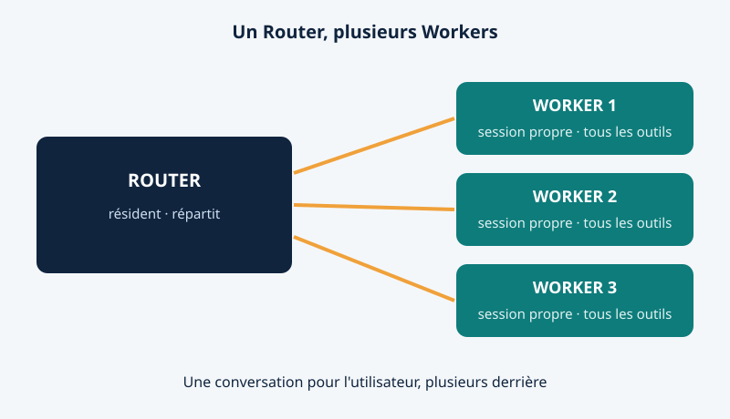
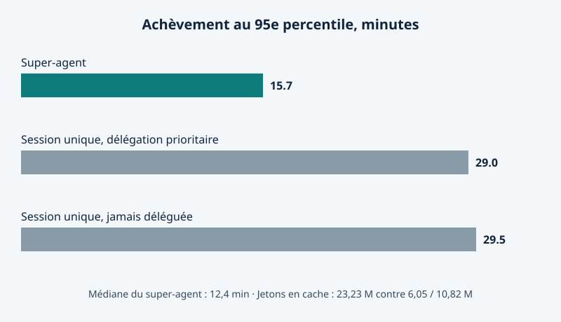

Le 31 octobre 2026, l'équipe Harness de DeepSeek a publié un essai qui affirme une chose peu à la mode : le prochain goulot du codage par IA n'est pas le modèle. C'est vous. *Super-agent Design Exploration* soutient qu'une tâche seule est limitée par le modèle, mais que plusieurs tâches à la fois sont limitées par l'attention humaine — une personne ne suit en général que trois à cinq sessions actives. Avec lui, un prototype de recherche, dsh-superagent-prototype, sous licence MIT : pas un nouveau modèle, mais une nouvelle façon d'organiser les modèles existants.

## Un standard et des établis séparés

Le système a deux couches. Le Router est une session éveillée, qui reçoit les demandes de tous les canaux et garde ce qui est partagé entre les tâches. Il ne fait que parler et répartir, et un modèle plus léger suffit souvent, car coordonner est plus simple que coder.

Chaque Worker est une session séparée, avec son contexte et son répertoire, dotée de tous les outils et du modèle le plus fort, puisque c'est lui qui détermine la qualité du code. Une chasse au bug, une réponse de revue et une fonctionnalité peuvent donc avancer en même temps, chacune dans son espace. Quand un Worker termine, il rend compte au Router, qui répond à l'humain à sa place : une seule conversation pour l'utilisateur, plusieurs derrière elle.

<figure>

<figcaption>Figure 1 — Le Router parle aux humains et répartit ; chaque Worker possède un seul travail, sa session et son répertoire, et rend compte par le Router.</figcaption>
</figure>

## Il écoute avant de parler

Le super-agent est piloté par des événements — Triggers : un message de chat, un rappel de calendrier, un commentaire de revue, un résultat de test. Les chats de groupe sont bruyants, donc les événements passent un filtre à deux niveaux : un Fast Path les admet selon la source, le groupe et une liste d'autorisation, puis un Slow Path, fondé sur un modèle, juge les survivants selon une politique.

Les suites échappent à la file d'attente : les événements d'une même pull request ou d'un même sujet forment un Thread, et le Worker qui le prend s'y abonne, les messages suivants lui parviennent donc directement, et deux Workers sur une même pull request voient tous deux les nouveaux événements.

La mémoire est tout aussi économe : la fenêtre de contexte fonctionne comme un cache, chaque objet portant les identifiants des objets liés, si bien que le modèle suit une chaîne de rappels au lieu de recharger tout l'historique.

Puis vient la partie proactive. Dans le groupe interne de DeepSeek, l'agent était réglé pour reproduire et corriger silencieusement les bugs signalés, et ne parler qu'une fois le problème confirmé et un correctif simple trouvé : pendant que les membres discutaient encore d'un bug où les tildes s'affichaient comme des barrés, il avait déjà ouvert une pull request de correctif.

## Les chiffres, honnêtement étiquetés

L'équipe a testé le système sur un flux synthétique : environ 300 messages, une vingtaine de vraies demandes, cinq exécutions par configuration. Le codage a été remplacé par un outil qui consomme simplement du temps, et les durées ont été ramenées au quart — le test mesure donc l'ordonnancement, pas la qualité du code, et les auteurs qualifient les résultats de préliminaires.

<figure>

<figcaption>Figure 2 — Sur la charge synthétique, le super-agent a terminé 95 % des tâches en 15,7 minutes, contre 29,0 et 29,5 minutes pour les configurations à session unique — mais il a lu beaucoup plus de jetons en cache (23,23 millions contre 6,05 et 10,82 millions).</figcaption>
</figure>

La moitié des tâches s'est achevée en 12,4 minutes, 95 % en 15,7 minutes, contre 29,5 minutes au 95e percentile pour une session unique qui ne délègue jamais ; une session qui délègue en priorité a dérivé jusqu'à 29,0 minutes. Le prix à payer : 23,23 millions de jetons en cache par exécution, contre 6,05 et 10,82 millions. Sous charge, le Router monte bien en charge : quand les événements sont passés d'environ 1 à environ 40 par minute, les décisions groupées ont ramené le temps d'inférence par décision de 6,4 à 1,6 seconde.

## Ce qui a vraiment été livré — et ce qu'il faut surveiller

Ici, l'histoire se resserre. Le prototype public est un agent de codage proactif pour un seul dépôt GitHub, livré comme un bundle pour DeepSeek Harness, le runtime open source de l'équipe. Il écoute GitHub et, en option, Feishu ; une demande autorisée devient un élément de travail avec sa session et son répertoire, et le résultat revient dans la conversation d'origine, en pull request.

Mais le README est clair : code de recherche seulement, pas un produit officiel de DeepSeek, pas prêt pour la production. Écrit en grande partie par des agents de codage, il diffère de la version interne, et certaines idées de l'essai ne sont pas mises en œuvre. L'instance interne — qui corrige discrètement des bugs chez DeepSeek même — est plus capable que ce qui a été publié.

Des comptes rendus notent que les Workers exécutent des commandes sans approbation, en tant qu'utilisateur du système, et que Harness est expérimental : examinez les plugins et les commandes, exécutez avec des privilèges minimaux.

## Pourquoi cela compte quand même

Aucun nouveau modèle n'a été annoncé le 31 octobre, et c'est le point. Le débat sur la frontière portait sur des modèles plus grands et plus intelligents ; le super-agent dit que les prochains gains viendront de l'organisation — traiter l'attention humaine comme la ressource rare, à dépenser pour les décisions, pas pour la gestion des sessions. Les outils payants vendent un modèle et une fenêtre de chat ; DeepSeek vient de publier, gratuitement, un modèle d'organisation pour transformer n'importe quel modèle en équipe avec un chef. Les rivaux peuvent le copier, mais ils ne peuvent pas faire disparaître l'idée que le gardiennage est facultatif.

Le revers : un agent qui corrige silencieusement les bugs est merveilleux jusqu'à ce qu'il fasse silencieusement quelque chose que vous n'auriez pas approuvé. Listes d'autorisation, filtres et tableau de bord sont la réponse du système ; savoir s'ils suffisent pour un système conçu pour demander le moins d'attention possible est une question que chaque équipe qui l'installe devra trancher.

Si votre agent de codage pouvait corriger discrètement les bugs avant que vous les remarquiez, jusqu'où le laisseriez-vous agir sans supervision avant qu'il doive demander ?

Sources : https://agentspulse.github.io/tutorials/deepseek-super-agent-architecture/ , https://www.aiaffairs.com/technology/deepseek-harness-super-agent-coding-prototype/ , https://chinamodelapi.com/news/deepseek-superagent-open-source , https://cointelegraph.com/news/deepseek-developing-ai-agent-requiring-less-human-input-report
