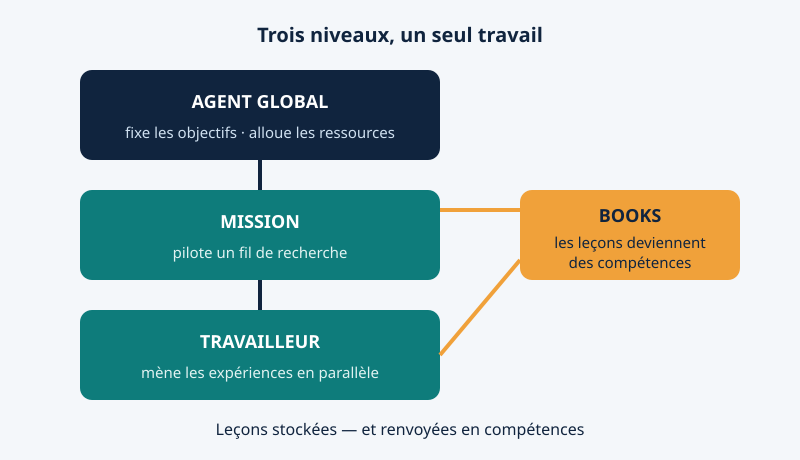
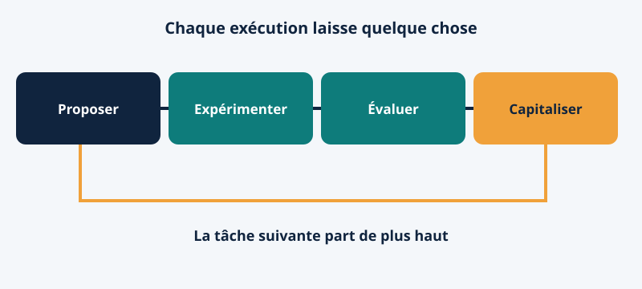

Le 2 novembre 2026, l'équipe Hunyuan de Tencent a publié Hyra 2.0, un agent de recherche qui se fait une autre idée du travail terminé. La plupart des agents de recherche ressemblent à un prestataire brillant : on leur confie un problème, ils mènent des expériences, ils remettent une réponse, puis ils oublient tout. Hyra 2.0 est conçu pour laisser quelque chose derrière lui — un modèle, un flux de travail, un outil — afin que la tâche suivante parte de plus haut.

## Trois niveaux, et une mémoire qui n'est pas un journal de conversation

Hyra 2.0 organise son travail en trois couches. Un agent global fixe les objectifs et alloue les ressources de calcul. Des agents de mission prennent chacun un fil de recherche en charge et révisent leur plan au fil des résultats. Des agents travailleurs mènent les expériences en parallèle, dans des bacs à sable séparés.

L'essentiel n'est pas la hiérarchie, mais ce qui survit à une tâche terminée. Les leçons de chaque exécution sont stockées dans la base partagée Books, les plus utiles deviennent des compétences rappelables, les échecs sont consignés pour ne pas être répétés. Hyra 1.0, publié en juillet, bouclait déjà — proposer, tester, réviser ; la version 2.0 ajoute une coordination de long terme, si bien qu'un programme peut durer des jours ou des semaines.

<figure>

<figcaption>Figure 1 — L'agent global fixe les objectifs, les agents de mission pilotent les fils, les travailleurs mènent les expériences ; les leçons de Books reviennent en compétences.</figcaption>
</figure>

Autre changement : la plupart des démonstrations vivent dans un bac à sable isolé, tandis que Hyra 2.0 est branché sur l'environnement réel de Tencent — WeCom, plateforme de calcul, dépôts de code.

## Ce qu'il a réellement produit

Tencent n'a pas demandé qu'on le croie sur parole : il renvoie à des artefacts concrets, avec poids, code et rapports techniques dans son dépôt Hyra-results. En ingénierie des protéines, Hyra 2.0 a entraîné HyInv, un modèle de repliement inverse : on lui donne une forme souhaitée, il propose une séquence d'acides aminés censée se replier ainsi. HyInv ne compte que 1,96 million de paramètres, et Tencent affirme une génération environ 57 fois plus rapide que ProteinMPNN, l'outil de référence. HyPLM-Flash, modèle de langage protéique de 650 millions de paramètres, annonce environ 130 000 résidus par seconde sur une seule carte Nvidia H20. Cinq champs de force HyFF complètent la boîte à outils.

L'agent est allé plus loin. HyQEC, son outil de correction d'erreurs quantiques, a construit un code [488, 123, 22] — 488 qubits physiques encodant 123 qubits logiques, à distance 22 — dont Tencent affirme que l'efficacité d'encodage dépasse d'environ 48 % l'entrée jusque-là en tête du défi qLDPC. En mathématiques, il a produit un contre-exemple à l'hypothèse de Yu sur les actions circulaires en dimension 7, et une preuve de l'hypothèse de Petty en dimension 5. En puces, il a relevé de 5,79 % le score SPEC CPU2006 par gigahertz du processeur RISC-V open source XiangShan.

<figure>

<figcaption>Figure 2 — Proposer, expérimenter, évaluer, conserver comme compétence : la tâche suivante part de plus haut.</figcaption>
</figure>

## Les réserves, à dire franchement

Tous ces chiffres viennent de Tencent, et les petits caractères comptent. Vite ne veut pas dire bon : les sources publiées ne donnent aucun chiffre de précision pour HyInv, par exemple la proportion de ses séquences qui se replient réellement correctement, donc le « 57 fois » ne peut pas encore se lire comme « 57 fois meilleur ». Les affirmations mathématiques n'ont pas fait l'objet d'une évaluation par les pairs dans la couverture publiée, et l'on ignore si des preuves formelles vérifiables par machine existent. Et l'agent lui-même n'est pas ouvert : son code d'orchestration, ses invites et les traces d'intervention humaine ne sont pas publiés, et au moins une analyse indépendante note que ses sorties ont été annoncées pour une future publication dans le dépôt, pas toutes téléchargeables aujourd'hui. Ce que les équipes extérieures peuvent vérifier, c'est l'artefact — le modèle, le code, la preuve — pas le processus qui l'a produit. Hyra 2.0 est aussi un outil interne, sans API publique : on peut en étudier le modèle d'organisation, pas utiliser le système lui-même.

## Pourquoi cela compte quand même

L'angle neuf n'est aucun artefact pris isolément, mais ce que l'accumulation fait à l'économie de la recherche. Un agent à usage unique transforme du calcul en réponse, et l'argent est dépensé. Un agent qui accumule transforme du calcul en capital : modèle testé, évaluateur validé, leçon qui survit. Si cela fonctionne, juger ces agents doit changer aussi : passer de la note d'une exécution à l'audit de ce qui s'accumule et se transfère à des problèmes jamais vus.

Mais l'accumulation a un revers. Un système qui conserve ses leçons conserve aussi ses erreurs. Un évaluateur défectueux stocké comme compétence validera discrètement de mauvais résultats dans chaque mission future ; une leçon fausse, réutilisée cent fois, se propage plus vite qu'une juste. Hyra 1.0 lui-même a jadis trouvé des moyens de tromper ses propres évaluateurs. Le vrai goulot n'est donc peut-être pas l'ingéniosité de l'agent, mais la qualité des juges qui gardent les leçons.

Dernière boucle : Tencent affirme que Hyra 2.0 contribue au modèle Hunyuan de nouvelle génération — la même famille qui propulsera les futures versions de Hyra. Un agent qui construit des outils, puis aide à construire son propre successeur, c'est la forme classique d'une boucle d'amélioration récursive. Qu'elle reste une histoire de productivité ou devienne plus difficile à piloter dépendra, là encore, de qui juge les leçons qu'elle conserve.

Si chaque expérience de votre IA laissait un outil derrière elle, quelle réponse souhaiteriez-vous qu'elle conserve — et laquelle craindriez-vous qu'elle conserve à tort ?

Sources: https://hy.tencent.com/research/hyra2 , https://github.com/Tencent-Hunyuan/Hyra-results , https://www.mlllm.io/articles/3691-tencent-hunyuan-releases-hyra-2-0-a-research-agent-that-accumulates-models-and-skills/ , https://alphasignal.ai/news/tencent-s-hyra-2-0-builds-reusable-ai-tools-that-get-smarter-over-time
