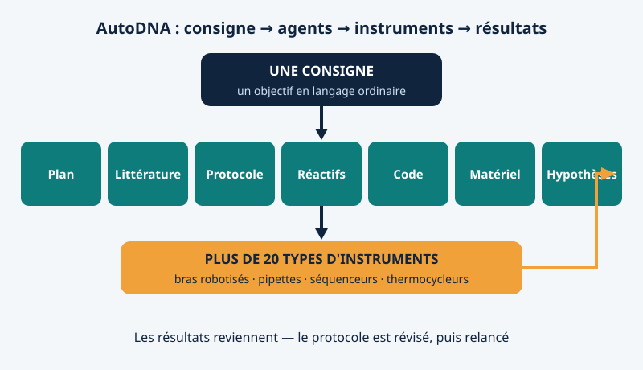

Le 4 novembre 2026, *Nature* a [publié AutoDNA](https://www.nature.com/articles/s41586-026-11228-6), un laboratoire de l'université Jiao Tong de Shanghai où un humain tape une seule phrase en langage ordinaire — et une équipe d'agents IA conçoit l'expérience, écrit le code des instruments, pilote plus de vingt types d'appareils, vérifie les résultats et corrige le protocole quand quelque chose dérive. Les mains humaines ne reviennent que pour recharger les réactifs et changer les consommables, comme le note le [reportage de *Nature*](https://www.nature.com/articles/d41586-026-03552-8).

## Conçu autour des agents, pas équipé après coup

Les laboratoires ont des robots depuis des décennies. Ce qu'ils automatisaient, ce sont les mains : pipeter, chauffer, déplacer des plaques. La réflexion restait humaine. Dans la plupart des systèmes actuels, comme l'a dit l'auteur senior Haibo Chen à *Nature*, des experts configurent encore chaque instrument, et l'IA ne s'occupe que d'une partie du processus.

AutoDNA, mené par Mingyu Wu avec Chen comme auteur senior, fait l'inverse. Modèles, expériences et instruments ont été conçus ensemble, pour que les agents raisonnent dans le même souffle sur un objectif chimique et une contrainte matérielle.

## Sept spécialistes, une vingtaine d'instruments

Le travail est réparti entre agents spécialisés. Un planificateur découpe l'objectif en étapes. Un agent « littérature » cherche ce qui est connu ; un agent « protocole » rédige la procédure ; un agent « réactifs » vérifie que les produits existent vraiment ; un agent « code » écrit les programmes de contrôle ; un agent « matériel » ordonnance les machines et peut substituer un appareil équivalent quand celui visé est occupé ; un agent « hypothèses » propose des améliorations quand les résultats manquent leur cible. Puis la boucle recommence : concevoir, expérimenter, optimiser.

En dessous, le laboratoire physique : bras robotisés, pipettes, thermocycleurs, blocs chauffants, portoirs magnétiques et séquenceurs nanopores — plus de vingt types d'instruments au total. La plateforme peut aussi servir plusieurs utilisateurs à la fois, en réordonnançant les étapes quand leurs travaux se chevauchent.

<figure>

<figcaption>Figure 1 — Une consigne, sept agents spécialisés, une vingtaine d'instruments — et des résultats renvoyés pour réviser le protocole.</figcaption>
</figure>

## Trois résultats vérifiables

**Une phrase stockée dans l'ADN.** L'équipe a demandé à AutoDNA d'encoder dans l'ADN la citation « Intelligence is the ability to adapt to change ». Les agents ont conçu le codage, synthétisé 78 brins d'ADN, les ont stockés, amplifiés, séquencés, puis décodés. Ce stockage a demandé plus de 11 000 opérations d'instruments en environ 200 heures, et le texte d'origine est revenu exactement, caractère pour caractère.

**Un niveau d'expert, trouvé par essais.** En synthèse enzymatique d'ADN, les agents ont ajusté tour après tour les temps de réaction, les concentrations de réactifs et les étapes de lavage. Le rendement par étape a atteint 97,8 %, égalant les résultats publiés d'optimisations menées par des experts. Et en menant plusieurs protocoles en parallèle, en se réordonnançant les uns autour des autres, ils ont fini 3,2 fois plus vite que l'un après l'autre.

**Une mutation cancéreuse connue, détectée.** À partir d'un échantillon de cancer colorectal prétraité, AutoDNA a conçu et synthétisé ses propres amorces de détection et correctement identifié la mutation KRAS G13D que l'échantillon était connu pour porter.

Un détail en dit long. Pendant une expérience de détection, les agents ont décidé d'eux-mêmes de fermer les tubes de réaction pendant l'incubation, pour éviter l'évaporation. Personne ne le leur avait demandé. C'est le geste que les chercheurs expérimentés font sans y penser, et que les débutants oublient dans les protocoles écrits.

## Ce qui a vraiment été automatisé

Le pipetage n'a jamais été la partie difficile. La ressource rare d'un laboratoire, c'est le jugement expert : savoir concevoir le protocole, repérer un résultat qui sent l'erreur, décider quoi essayer ensuite. C'est cette couche-là qu'AutoDNA automatise. Si elle voyage au-delà d'un seul laboratoire, une expérience cesse d'être le privilège d'une équipe de spécialistes pour devenir quelque chose qui ressemble à un service qu'on demande en langage ordinaire. Les auteurs présentent leur conception comme un plan pour exactement cela.

## À lire les yeux ouverts

Les réserves sont réelles. Il s'agissait de tâches de validation contrôlées, pas d'une découverte : la mutation KRAS était déjà connue, et stocker une courte phrase prouve un cycle qui fonctionne, pas une archive pratique. Des humains rechargent toujours réactifs et consommables et entretiennent le matériel, et des pannes pendant ces campagnes ont parfois exigé des mains humaines après tout. Le système n'existe que dans un seul laboratoire et ne travaille que sur la chimie des acides nucléiques. Et le travail lui-même n'est pas tout neuf : un preprint est public depuis juillet 2025 (arXiv:2507.02379). La nouveauté de cette semaine, c'est son passage en revue par les pairs dans *Nature*. Code et données sont ouverts, sur GitHub et Zenodo, pour que d'autres testent jusqu'où cela se généralise.

Quand la machine peut concevoir l'expérience autant que l'exécuter, que reste-t-il que seul le scientifique humain puisse faire — choisir la question, ou savoir quand la réponse de la machine est fausse ?
