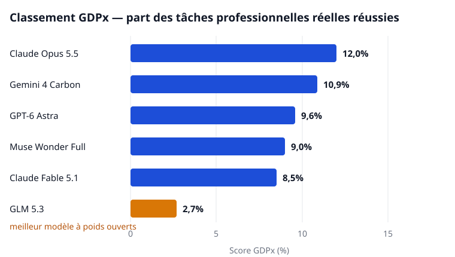

Le 2 novembre 2026, le cabinet de recherche SemiAnalysis a publié [GDPx](https://gdpx.semianalysis.com), un benchmark construit sur une idée inconfortable : cesser de poser des questions d'examen aux modèles d'IA et leur confier à la place du vrai travail de professionnel — une acquisition à analyser, un contrat à corriger, une puce à concevoir — avec jusqu'à huit heures pour finir et les exigences d'un praticien pour juger le résultat. Le meilleur score au monde : 12,0 %.

## Du travail, pas des questions

GDPx v1.0 compte 206 tâches réparties entre 11 domaines pondérés à parts égales : conception de puces, cybersécurité, biologie, finance, droit, trading quantitatif, auto-amélioration récursive, conception de matériel, science des matériaux, alignement et génie logiciel. Quatorze entreprises spécialisées ont construit les tâches dans des environnements de travail simulés. Le volet finance, par exemple, reconstitue une acquisition réelle de 880 millions de dollars dispersée dans environ 4 000 fichiers anonymisés, que le modèle doit explorer comme le ferait un analyste. Chaque modèle dispose de trois tentatives par tâche ; le score est son taux de réussite au premier essai, en moyenne. La plupart des domaines notent en réussite ou échec, quelques-uns utilisent des notes continues.

GDPx succède à GDPval d'OpenAI, publié en septembre 2025, qui notait des documents finis sans jamais laisser le modèle travailler de façon interactive. Pour les auteurs de GDPx — Max Kan, Andrew Megalaa et Dylan Patel —, la différence est précisément l'objet du test : le vrai travail consiste à ouvrir les fichiers, utiliser les outils et corriger ses propres erreurs pendant des heures, pas à produire une seule réponse soignée.

## Le classement

<figure>

<figcaption>Figure 1 — Scores GDPx des cinq premiers modèles, plus le meilleur modèle à poids ouverts, GLM 5.3. Source : classement GDPx, SemiAnalysis.</figcaption>
</figure>

Claude Opus 5.5 mène avec 12,0 % — environ une tâche sur huit menée à un résultat acceptable. Gemini 4 Carbon suit à 10,9 %, GPT-6 Astra à 9,6 %, et Muse Wonder Full de Meta à 9,0 %. Le meilleur modèle à poids ouverts, GLM 5.3 de Z.ai, atteint 2,7 %. En finance et en droit, le plancher s'effondre : avec une notation stricte en réussite ou échec, pratiquement tous les modèles obtiennent zéro, et SemiAnalysis y publie donc des crédits partiels à la place. Sur une tâche juridique publique, aucune des 20 tentatives n'a produit une version corrigée d'un contrat qu'un avocat pourrait utiliser.

## L'argent ne règle pas le problème

La colonne des coûts raconte sa propre histoire. Les exécutions d'Opus 5.5 coûtent en moyenne 51,41 dollars par tâche. Le modèle le plus cher du classement, Claude Fable 5.1 à 67,16 dollars par tâche, obtient un score inférieur : 8,5 %. Gemini 4 Carbon prend la deuxième place pour environ un tiers du prix du leader. Et DeepSeek 4.1 Flash, à 0,94 dollar par tâche — environ un cinquante-cinquième de la facture d'Opus — atteint quand même 5,4 %, près de la moitié du meilleur score. Payer plus achète bien des agents plus forts, mais pas des agents proportionnellement plus forts.

Les lecteurs de ce site ont déjà rencontré la version quantitative de cette histoire. Dans [l'étude Quant-Arena](https://opensilabs.github.io/fr/2026-10-31-quant-arena) que nous avons couverte récemment, neuf modèles de pointe ont écrit des stratégies de trading pour 3 042 actions A chinoises, et aucun n'a battu le simple fait de détenir tout le marché. Le trading quantitatif est l'un des 11 domaines de GDPx, et Opus 5.5 l'a même remporté — mais SemiAnalysis rapporte que, dans la plupart des exécutions quantitatives notées, les modèles sont restés derrière une simple stratégie de référence. Un autre domaine mérite qu'on s'y arrête : l'auto-amélioration récursive, le pari de tout le secteur selon lequel l'IA accélérera bientôt son propre développement, figure sur le même tableau que la rédaction de contrats, et aucun modèle n'est près de maîtriser ni l'un ni l'autre.

## À lire avec les yeux ouverts

GDPx est un instrument de mesure, pas un nouveau modèle ni une nouvelle méthode — et cet instrument a un propriétaire. C'est un produit payant de SemiAnalysis ; la plupart des tâches construites par les partenaires sont privées et sans audit externe, et aucun groupe indépendant n'a encore reproduit ces chiffres. Une partie de l'écart vient aussi des laboratoires eux-mêmes : les classificateurs de sécurité d'Opus 5.5 et de GPT-6 Astra refusent ou interrompent le travail dans les domaines cybersécurité, biologie et alignement, ce qui tire leurs moyennes vers le bas ; SemiAnalysis publie d'ailleurs un classement alternatif sans ces trois domaines. Enfin, il faut protéger le titre contre lui-même. Ces 12 % sont un taux de réussite sur 206 tâches précises, choisies pour leur valeur économique. Ce n'est pas une mesure de tous les métiers du monde, et le zéro général en finance et en droit en dit autant sur l'exigence des livrables réels que sur les modèles.

Pendant des années, le domaine a surtout mesuré ce que les modèles savent. GDPx mesure ce qu'ils peuvent terminer — et lors de la première tentative sérieuse de cette mesure, la meilleure machine du monde laisse sept tâches sur huit inachevées. La vitesse à laquelle ce chiffre grimpera désormais, voilà le débat qui compte.
