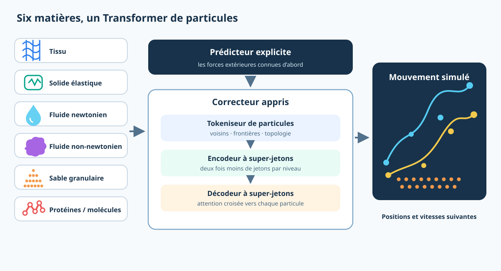

Une dune, une chemise, une éclaboussure, un bloc de caoutchouc et une protéine ne ressemblent pas au même problème de calcul. WorldParticle les traite pourtant ainsi. Chaque objet devient un ensemble de milliers ou de millions de particules tridimensionnelles, dotées d'une position, d'une vitesse et de propriétés physiques. Un Transformer prédit ensuite leur mouvement, pas à pas.

Le travail réunit Caoliwen Wang, Minghao Guo, Peter Yichen Chen, Wojciech Matusik et leurs collègues du MIT, de l'université de Colombie-Britannique et d'autres institutions. L'[article](https://arxiv.org/abs/2605.15305) a été mis en ligne en mai 2026. Les jalons de novembre sont sa publication dans *ACM Transactions on Graphics* et le [reportage de MIT News](https://news.mit.edu/2026/single-ai-model-simulates-many-substances-behavior-1109) ; SIGGRAPH Asia suit en décembre — pas un nouvel article de novembre.

## La simulation classique est un assemblage

Un fluide peut être représenté par une grille ou par des particules lissées. Les tissus et les solides élastiques utilisent souvent des maillages et les éléments finis. Le sable demande une mécanique granulaire ; les protéines, des potentiels atomistiques. Chaque choix apporte ses équations, ses approximations et son logiciel.

WorldParticle commence par une langue commune. Dans une représentation lagrangienne, le calcul suit la matière pendant qu'elle se déplace, au lieu d'observer ce qui traverse des points fixes. Les sommets d'un maillage, les échantillons d'un fluide et les atomes deviennent tous des particules.

## Calculer ce qui est connu, apprendre le reste

Chen rapproche l'architecture de celle de ChatGPT, sauf qu'elle prédit le mouvement des particules plutôt que le mot suivant. À chaque pas, un prédicteur explicite applique d'abord les forces extérieures connues, comme la gravité ou une poussée. Il obtient un état provisoire raisonnable, mais ne peut pas déduire les collisions, la pression, le frottement ou les liaisons entre particules.

Un correcteur appris prédit alors les changements manquants de position et de vitesse. Un tokeniseur de particules examine les relations locales : particules voisines, contacts avec les frontières et topologie des connexions fixes. Un encodeur à super-jetons regroupe ensuite les jetons de particules en unités plus grandes ; leur nombre diminue de moitié à chaque niveau, en alternant fusion et attention. Des régions éloignées peuvent échanger de l'information sans que chaque particule examine toutes les autres. Enfin, un décodeur à super-jetons utilise l'attention croisée pour transformer cette vue compressée en correction propre à chaque particule.

L'architecture reste identique pour les six catégories. Seules les données d'entraînement changent.

<figure>

<figcaption>Figure 1 — Six dynamiques de particules entrent dans une architecture fixe : un prédicteur explicite traite les forces connues, puis un correcteur appris calcule les interactions avec des jetons de particules et des super-jetons.</figcaption>
</figure>

## Le sable retombe ; les protéines avancent par bonds bien plus grands

Pour chaque catégorie, l'équipe a entraîné un jeu de paramètres sur des trajectoires produites par des solveurs établis. Les tests ont changé les matériaux, les formes, les frontières, les états initiaux et les forces. MIT News résume les résultats comme une précision supérieure aux méthodes de simulation numérique dans les six phénomènes. L'exemple du sable est plus parlant : un tas granulaire en forme de tigre, géométrie absente de l'entraînement, s'effondre et s'étale de façon plausible avec WorldParticle, alors que certaines méthodes neuronales concurrentes laissent des grains suspendus dans l'air.

Pour les protéines, le gain de vitesse se lit dans le pas de temps. WorldParticle prédit la rotation des chaînes latérales avec des pas de 50 femtosecondes, contre 0,5 femtoseconde pour la simulation traditionnelle utilisée dans l'article. Guo décrit la modélisation des protéines comme environ 100 fois plus rapide. Ce chiffre concerne ce cas précis, pas toutes les matières.

La même conception a servi à appliquer des forces de façon interactive, à retrouver un coefficient de frottement par conception inverse, et à apprendre de manipulations réelles.

## Pourquoi un simulateur commun compte

Un simulateur partagé ne ferait pas seulement gagner du temps de programmation. Si les tissus, les fluides et les solides mous parlent la même langue de calcul, on peut les coupler, tester une conception de manière interactive ou chercher quel paramètre modifier pour atteindre un objectif. WorldParticle se distingue aussi des modèles du monde vidéo : il prédit un état physique explicite — positions et vitesses — que l'on peut inspecter et réutiliser, au lieu de seulement produire des images plausibles.

C'est pour cela que Chen parle d'un « moment GPT pour la simulation » et que l'équipe présente ce travail comme un premier pas vers un modèle de fondation pour la physique : un simulateur prêt à l'emploi dans de nombreux scénarios, plutôt qu'un nouvel outil à reconstruire pour chaque phénomène.

## Les limites font partie du résultat

L'unité est architecturale ; il n'existe pas encore un modèle unique entraîné pour tout. L'article dit clairement qu'un jeu de paramètres est entraîné par catégorie de dynamique. Des poids partagés entre les six catégories restent un objectif futur. Les auteurs reconnaissent aussi une perte de précision, phénomène par phénomène, par rapport aux solveurs classiques spécialisés. Et comme WorldParticle apprend à partir de trajectoires générées par ces solveurs, il peut hériter de leurs hypothèses et de leurs erreurs. Il ne déduit pas la physique de la seule observation brute.

Les résultats de précision et de vitesse viennent de l'équipe elle-même, sans réplication indépendante pour l'instant. Les longues simulations restent le point faible général des simulateurs autorégressifs : les petites erreurs s'accumulent. La séparation prédiction-correction a réduit le problème dans ces tests, sans le supprimer. La mémoire impose une autre limite : le langage des particules peut décrire des millions de points, mais l'implémentation actuelle en traite environ 50 000 sur un GPU A100 de 80 Go, parce que sa première couche applique l'attention à pleine résolution.

WorldParticle n'a pas remplacé la boîte à outils des spécialistes. Il montre qu'une architecture fixe et soigneusement structurée peut apprendre plusieurs types de matière par la même interface — et ce pas-là pourrait compter davantage.

Si changer les données d'entraînement suffit un jour à apprendre une nouvelle matière à un seul simulateur, que signifiera comprendre la physique : retrouver l'équation qui gouverne le phénomène, ou prédire la matière assez bien pour concevoir à partir de la réponse ?
