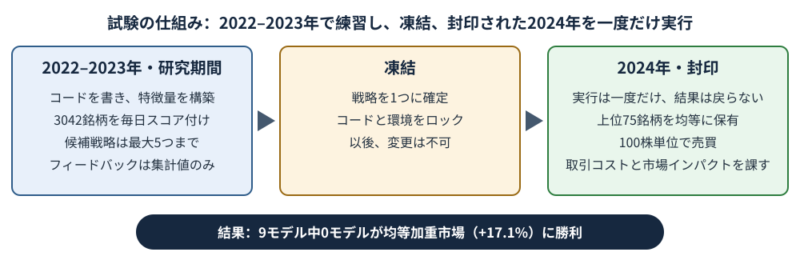
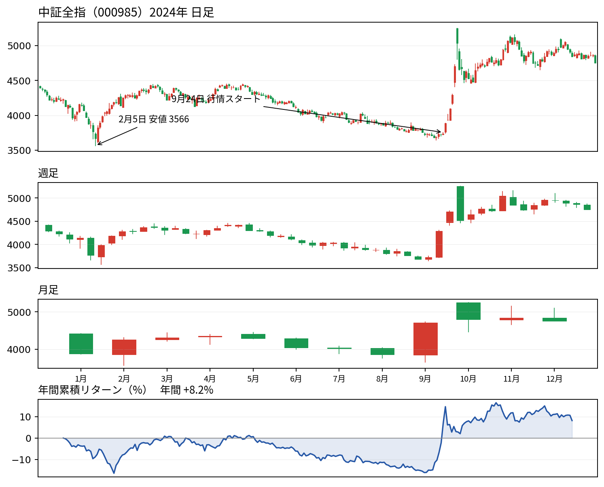
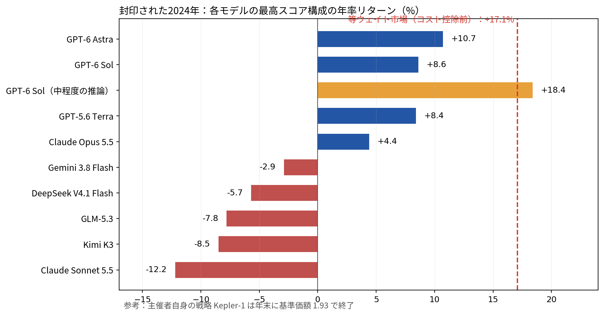

数週間おきに「AIモデルが株式市場に勝った」という見出しが現れる。その主張のほぼ全てはバックテストに基づいている。モデルに過去数年分の株価を見せ、「あの時どうしていればよかったか」を答えさせる試験だ。しかしこの試験には根本的な問題がある。大規模言語モデルは過去を読んでいる。2021年のニュースを見せても、それは予測ではなく、物語の結末を覚えているだけかもしれない。

Navers LabとEinsia.AIのチームは、この試験をまともに実施することにした。彼らのベンチマーク「Quant-Arena」(Houde Qianら12名、2026年10月21日にarXivで公開)は、中国A株3042銘柄の生データをモデルに渡し、クオンツ研究者の仕事の全てを任せる。コードを書き、シグナルを考案し、テストし、一つの戦略に決める。そして一度も見せてもらえなかった一年に、やり直しなしで臨む。現行最強の9モデルが受験した。封印された一年で、その全てが最も怠惰なポートフォリオ――全銘柄に同じ金額を投資する――に敗れた。

## 暗記では解けない試験

各モデルが受け取るのは、レベル2の個別の注文・約定記録まで含む生の市場データだ。モデルはPythonコードを書き、自ら特徴量(重要だと考える数値の手がかり)を構築し、3042銘柄全てを毎日スコア付けする。

研究期間は2022年から2023年。この2年間にテストできる候補戦略は最大5つまでで、返ってくるフィードバックは意図的に薄い。集計されたリターンとシグナルの統計だけで、封印された未来は決して見られない。5つという上限は重要だ。古いデータで十分な数の戦略を試せば、純粋な運で輝いて見えるものが必ず一つ現れるからである。

そして一つの戦略が凍結される。コードと実行環境はロックされ、2024年は正確に一度だけ実行され、結果はモデルに戻らない。審判は厳格なルールの現金口座だ。毎日、戦略が最高スコアを付けた75銘柄を保有し、中国の取引所の標準である100株単位で売買し、注文に応じた現実的な取引コストと、模擬注文板から推定したマーケットインパクト(自分の買いが価格を自分に不利な方向へ押し上げる、あの摩擦)を課す。口座で眠る現金の利息は正確に0%である。

<figure>

<figcaption>図1 — Quant-Arenaの手順。2年間の研究期間、候補戦略は最大5つ、その後コードはロックされ、封印された年は一度だけ実行される。</figcaption>
</figure>

## まず基準の話：「市場に勝つ」とは何か

モデルが勝たねばならなかった相手は、説明が必要だ。「市場」は一つの数字ではないからである。

Quant-Arenaの基準は、3042銘柄全ての均等加重ポートフォリオだ。全銘柄に同じ金額を投資する。銘柄選びも判断もなし。地方都市の小さな工房と最大の国有銀行が寸分違わず同じ重みを持つ。市場を持つ最も怠惰な方法であり、知性を一切必要としないからこそ、基準にふさわしい。

多くの読者が知っているのは別の種類の平均だ。CSI 300や中証全指(指数コード000985)のような大きな指数は時価総額加重で、企業が指数に占める重みはその規模に比例する。巨大銀行が動けば指数が動き、小型株はほとんど影響しない。同じ市場でも、二つの「平均」は大きく異なりうる。2024年、その差は大きかった。論文の均等加重リファレンスはコスト控除前(グロス)で+17.1%、時価総額加重の中証全指は+8.2%だった。均等加重が完全な一票を与える小型株の方が強い年だったため、モデルの前に置かれたバーは高かった。

以下で繰り返し出てくる指標が純資産価値、NAVだ。年初の1単位のお金が、後にいくらになっているかである。1.000で始まり1.170で終われば、17.0%の利益だ。

## 2024年：暴落、長期低迷、そして政策ラリー

封印された年は穏やかではなかった。幕開けは小型株の暴落だった。2024年1月から2月初め、中国の小型株は激しく下落し、中証全指は2月5日に日中安値3566を付けた。構造上、小型株に全額の重みを与える均等加重の物差しはさらに落ち込み、2月6日には0.704となった。1月1日に投資した1元が70セントの価値しかないということだ。

春に部分的な回復があった後、夏を通じて長い低迷が続いた。9月下旬になっても中証全指は年初の水準を下回っていた。そこへ9月24日、一連の政策発表がA株史上最も激しいラリーの一つに火を付けた。9月23日の終値から年末までに指数は27.1%上昇し、2024年を+8.2%で終えた。より荒い道を歩んだ均等加重リファレンスは1.170で終えた。

<figure>

<figcaption>図2 — 中証全指（000985)、時価総額加重、2024年の日足・週足・月足チャートと年間累積リターン（実データ、出典：テンセントの株価履歴）。中国市場の慣例で赤は上昇、緑は下落。この指数は2024年に+8.2%であり、論文の均等加重リファレンス（+17.1%）とは同じ市場の別の「平均」である。</figcaption>
</figure>

2023年末に凍結された戦略は、暴落、低迷、ロケットのような上昇という三幕全てを生き延びねばならなかった。

## 結果：プラスで終えたのは4モデルだけ

9モデル――GPT-6 Astra、GPT-6 Sol、GPT-5.6 Terra、Claude Opus 5.5、Claude Sonnet 5.5、Gemini 3.8 Flash、DeepSeek V4.1 Flash、Kimi K3、GLM-5.3――は、それぞれ複数の推論努力レベルで実行され、反復型の設定が38通り(フィードバックなしのワンショットも38通り)となった。以下のリターンは年率換算(1年間のテストなので、実質的にはその年の損益を年率で表したもの)で、口座が実際に支払った取引コストを差し引いた後の数字である。

どのモデルの最良の実行も+17.1%には届かなかった。総合スコア最高は、最高の推論努力レベルのGPT-6 Astraで+10.7%。市場に6.3ポイント後れを取ったが、最大ドローダウンはわずか−6.8%だった(最大ドローダウンとは、途中の高値から安値まで最悪の下落幅、つまり口座が落ち込んだ最も深い穴のこと)。続いてSolが+8.6%、Terraが+8.4%、Opus 5.5が+4.4%。残りの5モデルは損失を出した。Gemini 3.8 Flash −2.9%、DeepSeek V4.1 Flash −5.7%、GLM-5.3 −7.8%、Kimi K3 −8.5%、Claude Sonnet 5.5 −12.2%。年末に開始時よりお金が増えていたのは4モデルだけで、NAVは1.11、1.09、1.08、1.04。残りは0.88から0.97の間だった。

38通りの設定全体では、利益を出したのは13通りだけ。市場に勝ったのは正確に一つだけ、GPT-6 Solの中程度の推論努力で+18.4%。ただしその勝利の代償を見てほしい。最大ドローダウンは−35.9%。年で最も悪い瞬間、その口座の1元は約64セントまで落ちてから回復したのだ。36%の穴を耐えて市場を1.3ポイント上回るという交換を、ほとんどの投資家は受け入れないだろう。

<figure>

<figcaption>図3 — 各バーは封印された2024年における各モデルの最良スコア実行（年率リターン）。金色のGPT-6 Sol（中程度の推論）は市場ラインを上回った唯一の実行だが、途中で35.9%の最大ドローダウンを経験した。モデルのリターンは取引コスト控除後、均等加重市場のライン（+17.1%）はコスト控除前のグロスである。</figcaption>
</figure>

## なぜ敗れたか：ランキングは本物、ポートフォリオが弱い

著者たち自身の分析が最も興味深い。モデルは無知だったわけではない。銘柄の順位付けはできた。ただし、お金になるやり方ではなかった。

順位付けの腕前を示すスコア、RankICを考えよう。モデルの付けた順序が、その後の実際の成績順序とどれだけ一致するかを測る。1.0なら順位の完全な予言、0はコイン投げと同じだ。これは予測の成績表であって、銀行残高ではない。そして38通りの実行を通じ、RankICと実際のリターンの相関は0.09、実質的には無関係だった。GLM-5.3は順位付けが上手く(RankIC 0.046)、7.8%を失った。中程度の推論努力のClaude Opus 5.5は順位付けが偶然レベル(−0.002)だったのに、4.4%を稼いだ。

さらに悪いことに、順位は頂点で歪んでいた。モデルが順位付けした銘柄を10グループに分けると、9モデル中6モデルで、第2と第3のグループが最も稼ぎ(1日あたり24〜33ベーシスポイント、1ベーシスポイントは0.01%)、最上位グループ――モデルの一番のお気に入りであり、ポートフォリオが実際に買う唯一の銘柄群――はそれより稼げなかった。シグナルは実在したが微弱で、まさにお金が投じられる場所で薄れていた。

次にエクスポージャー(市場に投じている資金の割合)だ。ほとんどの戦略は資金の半分未満しか市場に置いていなかった。38通り中35通りで、平均エクスポージャーは34%から48%の間だった。眠る現金は0%しか生まない。17%上昇する市場に4割しか投資していない戦略は、銘柄選びが始まる前に上昇の大部分を手放し、それでも調整のたびに取引コストを払い続ける。あと二つの法則が全体像を完成させる。推論努力を上げても確実には報われず、9モデル中6モデルで最良の努力レベルは最高レベルではなかった。そしてフィードバックによる反復は、全モデルの総合スコアを上げたが、実際のリターンを上げたのは9モデル中4モデルだけだった。フィードバックが教えることの一部は、2022年から2023年という特定の時期の振る舞いである。平たく言えば過学習、つまり歴史の偶然に戦略をきつく合わせすぎて、リハーサルを暗記し本番で失敗する現象だ。最後に、スタイルも収束した。9モデル中8モデルが小型株に傾斜し、7モデルがバリュー(簿価に対して割安な株)、大半が低ボラティリティに傾いた。全員が共有する教科書通りのスタイルでは、誰も抜け出せない。

## 勝者は「隠れて」勝った

総合スコア最高のAstraは詳しく見る価値がある。その勝ち方こそ、この物語の縮図だからだ。

Astraの初期の候補は、研究期間の両年とも損失を出した。2022年に−12.2%、2023年に−13.6%。4番目と5番目の候補で、モデルは「市場状態スイッチ」を追加した。毎日、全銘柄ユニバースをチェックし、全銘柄の中央値の5日リターンと20日リターンが両方ともプラスなら株式を保有し、そうでなければ現金を保有する。シンプルなルールだ。市場全体が上がっている時だけ参加する。

封印された2024年、このスイッチはどんな銘柄選びよりも価値があった。均等加重市場が2月6日に0.704まで暴落する間、Astraの口座は正確に1.000のままだった。何も買っていなかったのだ。最初の購入は2月28日。1月から2月のドローダウンは−1.7%、市場の−29.6%に対してである。

しかし安全には代償があり、Astraはそれを払った。取引日の75%は現金保有だった。2月の安値からの反発では、市場の回復の16%しか取り込めなかった(投資し続けたTerraは73%を取り込んだ)。そして年間利益の12.5%は、9月24日から30日のわずか5営業日に生まれた。政策ラリーの時に、たまたま投資していたのである。最終的にNAVは1.107、市場の1.170に対して。一年の大半を隠れて過ごし、一週間の幸運で平凡さから救われた一年だった。それはリスク管理であり、本物の価値がある。だが銘柄選びの天才ではない。

## 主催者自身の戦略が示すこと

同じリーダーボードにはもう一行あり、正直に説明しなければならない。Kepler-1、Einsia.AIの独自戦略、つまりベンチマークを作ったチーム自身の戦略だ。スコアは77.56、最高のモデルの51.29に対して。2024年をNAV 1.93で終え、市場の1.17に対して大きく上回った。開示はここまでとして、事実は二つ残る。その口座は同じ評価器、同じルールで計算された。そしてその順位付け精度はAstraより低かった。RankIC 0.085、Astraの0.101に対して。一方、シャープレシオ(道中の揺れの単位あたりに得たリターン)は2.98で、最高のモデルの1.89を大きく上回った。

Kepler-1が重要な理由は二つある。第一に、この試験に合格できることを証明した。モデルは、バーが不可能なほど高いから失敗したのではない。第二に、差の在り処を示した。Kepler-1はAstraよりわずかに予測が下手で、はるかに多く稼いだ。違いは先見性ではなく変換だ。微弱なシグナルにどれだけのお金を張るか、どれだけ投資し続けるか、コストをどう抑えるか。その地味な機械装置こそ、モデルの弱点である。

## なぜ「封印」が要なのか

この封印の仕組みは大げさではないか、と思うかもしれない。2026年8月にArtul.ai Research Groupが発表した研究が、そうでない理由を示している。そのチームは言語モデルに165,182件の決算電話会議の記録をスコア付けさせ、リターンを予測するものについて約1,600の仮説を検証した。最良のシグナルは、分割半分検証、プラセボの質問、事前登録など、考案できる全てのバックテスト管理を通過した。次にそれを凍結し、12か月間見守った。凍結されたフォワードテストは、指数に対して中央値で−12.4%を失った。解剖で原因が分かった。銘柄のティッカーと日付だけを与え、文書は一切与えなくても、モデルは歴史上の勝者の66%から72%を「予測」できた。その時期を認識し、結果を覚えていたのだ。公開された歴史に対するバックテストは、モデルが解答集を持っているかもしれない試験である。

Quant-Arenaの防御は、その失敗に一対一で対応する。モデルが暗記しようのない封印された年、数百枚の宝くじを買わせないための候補5つまでの上限、そして取引コストの有効化。紙の上の利益は、実際の執行では蒸発しがちだからだ。

## 留保と結論

留保を率直に述べる。これは査読前のプレプリントだ。封印された年は一つ、市場は一つだけであり、2024年は暴落と政策ラリーという非常に特殊な形をしていたため、別の年であればモデルの順位は違ったかもしれない。市場のライン+17.1%はコスト控除前である一方、戦略はコストを支払っているので、バーはモデル側にわずかに不利に傾いている。実際の均等加重ポートフォリオの純リターンは17.1%未満になったはずだ。各設定は一度だけ実行され、運は平均化されていない。総合スコアの一部は未公開の計算式に基づいている。そしてKepler-1は主催者自身の戦略であり、その行については自らの答案を自ら採点している。

それでも中心的な発見は覆らない。発見そのものが控えめであり、この設計はこの問いに対してこれまでで最もクリーンなものだからだ。これは、言語モデルが株式について語るだけでなく、クオンツ研究者のループ全体――アイデア、コード、テスト、凍結、そして見たことのないデータでの生存――を遂行できるかを問う、初めての目立つ公開テストである。今のところの答えはこうだ。現行の最前線モデルは微弱で本物のシグナルを見つけるが、それをポートフォリオに変えることがまだできない。最良のモデルは、4日のうち3日は参加を拒否することで勝った。ボトルネックは予測ではなく、予測の後に来る全てである。

だから次の見出しのための実用的な指針を一つ。「我々のAIはX%のリターンを出した」とファンドやスタートアップやスクリーンショットが主張したら、一つだけ質問してほしい。戦略はテスト期間が始まる前に凍結されていたか、その期間は封印されていたか。答えが「いいえ」なら、それは証拠ではない。広告である。
