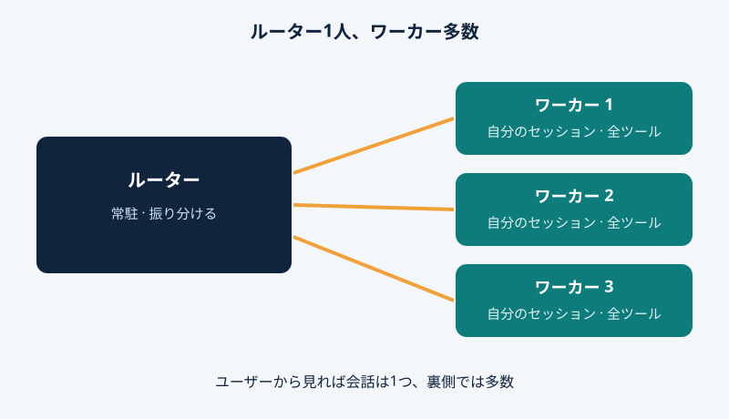
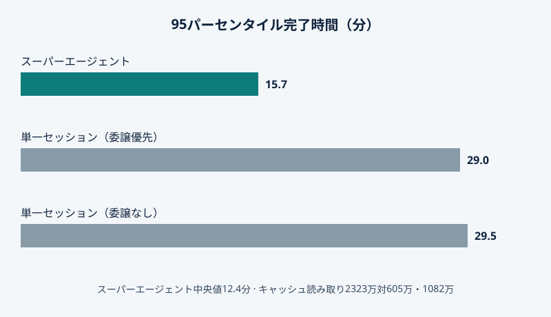

2026年10月31日、DeepSeekのHarnessチームが設計とMITプロトタイプdsh-superagent-prototypeを公開した。AIコーディングの次のボトルネックはモデルでなく人間で、人は3〜5件のセッションしか追えない。新モデルではなく、組織する方法だ。

## 管理者1人、作業者多数

設計は2層。ルーターは常駐の1セッションで、全チャネルの依頼を受け、共有情報を握る。話して振り分けるだけだ。ワーカーは独立セッションで、自分のコンテキストとディレクトリを持ち、全ツールと最強のモデルを使う。並行して進み、終えるとルーター経由で報告。

<figure>

<figcaption>図 1 — ルーターは人間と話し、仕事を振り分ける。各ワーカーは1件の仕事、自分のセッションとディレクトリを持ち、ルーター経由で報告する。</figcaption>
</figure>

## まず聞く

イベント駆動だ。トリガーはチャット、日程、レビューコメント、テスト結果。Fast Pathが送信元、グループ、許可リストで受け入れ、Slow Pathがポリシーで判定する。同じプルリクエストや話題はスレッドとなり、ワーカーが購読し、後続メッセージは直接届く。内部版はバグを黙って再現・修正し、確認後に声を上げる。

## 数字には正直な注釈を

実験は合成データ流。約300件のメッセージ、約20件の依頼、各設定5回。コーディングは時間消費ツールに置き換え、時間は4分の1に縮尺。測るのはスケジューリングで、結果は予備的。

<figure>

<figcaption>図 2 — 合成負荷で、スーパーエージェントは95%のタスクを15.7分以内に完了、単一セッション方式は29.0分と29.5分。代償はキャッシュ読み取り2323万トークン対605万と1082万トークン。</figcaption>
</figure>

タスクの半分は12.4分以内、95%は15.7分以内に完了。委譲しない単一セッションの95パーセンタイルは29.5分。代償はキャッシュ読み取り2323万トークン、605万と1082万を大きく上回る。

## 公開されたものと注意点

公開プロトタイプは単一GitHubリポジトリ向けで、DeepSeek Harnessのバンドル。GitHubと任意でFeishuを聴き、許可された依頼は作業項目になり、結果は元の会話にプルリクエストとして戻る。参考用の研究コードで、正式製品でなく、実運用には未対応。報道によれば、ワーカーは承認なしにOSユーザーとしてコマンドを実行。

## なぜ重要か

10月31日に新モデルは発表されなかった。次の利益は組織から来る。人間の注意を決定と承認にだけ使う。モデルをチームに変える型が無料で公開された。黙って承認しないことをするまでは、素晴らしい。許可リスト、フィルター、ダッシュボードが答えだが、十分かどうかは導入チームが答える。

エージェントが気づく前に黙ってバグを直せるとしたら、尋ねずにどこまで任せますか。
