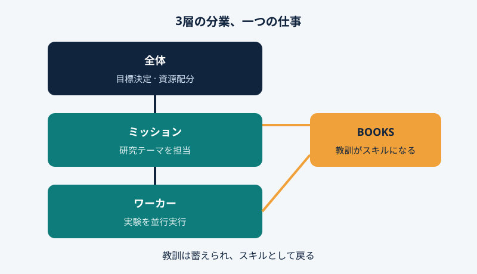
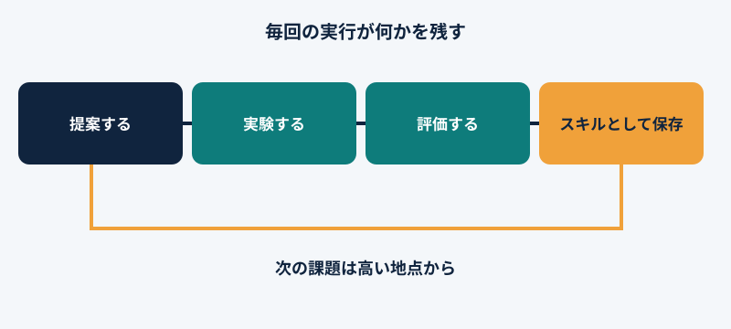

2026年11月2日、テンセントの混元チームが研究エージェントHyra 2.0を公開した。多くの研究エージェントは優秀な請負人のようだ。問題を受け取り、実験し、答えを渡して、すべて忘れる。Hyra 2.0は違う。モデルや道具といった「残るもの」を作り、次の課題は高い地点から始まる。

## 3層の分業と、忘れない帳簿

Hyra 2.0は3層で動く。全体（Overall）が目標を決め、資源を配分する。ミッション（Mission）は一つの研究テーマを担い、結果に応じて計画を修正する。ワーカー（Worker）は別々のサンドボックスで実験を並行実行する。

階層より重要なのは、課題の後に何が残るかだ。教訓はBooksに蓄えられ、有用なものはスキルになる。失敗も記録される。7月のHyra 1.0は「提案—実験—修正」の循環を持ち、2.0は長期統括を加えて数週間単位の計画を回せる。

<figure>

<figcaption>図 1 — 全体が目標を決め、ミッションがテーマを担い、ワーカーが実験を並行実行する。教訓はBooksに蓄えられ、スキルとして戻る。</figcaption>
</figure>

## 実際に生まれたもの

テンセントは成果物をHyra-resultsリポジトリで示した。HyInvは「逆折りたたみ」モデルで、望む形を与えると、その形に折りたたまるはずの配列を提案する。パラメータはわずか196万で、速度はProteinMPNNの約57倍だという。HyPLM-Flashは6億5000万パラメータで、H20 1枚で毎秒約13万残基をうたう。5つのHyFF力場もそろう。

さらに広がる。HyQECは[488, 123, 22]の量子符号を構築した。テンセントによれば、符号化効率はqLDPCチャレンジの従来首位を約48%上回る。数学では、7次元多様体上の円作用に関するYuの仮説の反例と、5次元でのPettyの仮説の証明を出した。チップでは、オープンソースのXiangShanプロセッサのSPEC CPU2006スコア（GHzあたり）を5.79%引き上げた。

<figure>

<figcaption>図 2 — 提案、実験、評価、スキルとして保存：次の課題は高い地点から始まる。</figcaption>
</figure>

## はっきりさせておく留保

数字はすべてテンセントのものだ。速いことは良いこととイコールではない。公開資料にHyInvの精度指標はなく、「57倍」を「57倍良い」とは読めない。数学の主張も査読を経ておらず、形式証明の有無は不明だ。エージェント自体もオープンではない。編成コード、プロンプト、介入記録は未公開で、独立した論評は、Hyra 2.0の成果物が将来の公開として発表されたのであって、今日すべてダウンロードできるわけではないと指摘する。外部が検証できるのは成果物であって、過程ではない。公開APIもない。

## それでも重要な理由

新しい視点は、個々の成果物にはない。蓄積が研究の経済を変えることだ。一回きりのエージェントは計算を答えに変え、費用は消える。蓄積するエージェントは計算を資本に変える。評価方法も変わらなければならない。1回の実行ではなく、何を蓄積し、どれだけ未知の問題に転移するかを監査することになる。

ただし蓄積は両刃の剣だ。教訓を残すシステムは、誤りも残す。欠陥のある評価器がスキルになれば、以後の課題で悪い結果を静かに通してしまう。誤った教訓を100回使えば、正しい教訓より速く広がる。Hyra 1.0自身、かつて自分の評価器をだます方法を見つけていた。真のボトルネックはエージェントの賢さではなく、教訓を残すかを決める「審判」の質かもしれない。

もう一つの循環にも注目したい。テンセントによれば、Hyra 2.0は次世代の混元モデルの学習と推論最適化に参加している。つまり将来のHyraを動かすモデル作りを手伝っているのだ。道具を作るエージェントが自分の後継者作りを手伝う、再帰的自己改善の典型だ。その循環が生産性にとどまるかは、残す教訓の審判にかかっている。

もしあなたのAIの実験がすべて、次のために道具を残すとしたら、今日の答えのうち、どれを最も残してほしいか。どの経験を誤って残されるのが最も怖いか。

Sources: https://hy.tencent.com/research/hyra2 , https://github.com/Tencent-Hunyuan/Hyra-results , https://www.mlllm.io/articles/3691-tencent-hunyuan-releases-hyra-2-0-a-research-agent-that-accumulates-models-and-skills/ , https://alphasignal.ai/news/tencent-s-hyra-2-0-builds-reusable-ai-tools-that-get-smarter-over-time
