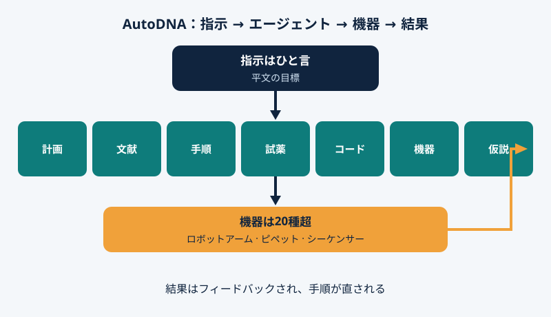

2026年11月4日、『Nature』が上海交通大学の[AutoDNAを掲載した](https://www.nature.com/articles/s41586-026-11228-6)。人が平文で目標をひと言入れると、AIエージェントのチームが実験を設計し、コードを書き、20種超の機器を動かし、ずれれば直す。人の手は[試薬補充と消耗品交換](https://www.nature.com/articles/d41586-026-03552-8)だけだ。

## エージェント前提の設計

ラボ自動化は昔からあるが、自動だったのは手作業、考えるのは人だった。Haibo Chen氏によれば、既存のシステムでは専門家が機器を設定し、AIは一部だけだ。Wu氏らのAutoDNAは逆に、モデル・実験・機器を一体で設計した。

## 専門役7つ、機器20種超

計画役が工程に分け、文献役が知見を探し、プロトコル役が手順を書き、試薬役が在庫を見て、コード役がプログラムを書き、ハードウェア役が機器を割り当て、仮説役が改善案を出す。設計、実験、最適化の輪が回る。実体はロボットアームやシーケンサーなど20種超だ。

<figure>

<figcaption>図1 — 指示はひと言、専門エージェントは7役、機器は20種超。結果は手順の修正に返される。</figcaption>
</figure>

## 検証できる3つの結果

**一文をDNAに保存。** 「Intelligence is the ability to adapt to change」を符号化し、DNA鎖78本を合成、保管、増幅、読み戻して復号した。機器操作11,000回超、約200時間で、原文が一字一句戻った。

**試行錯誤で専門家の水準に。** 酵素的DNA合成では条件を繰り返し調整し、収率97.8%。専門家の公表値に並んだ。並行実行は逐次より3.2倍速い。

**既知のがん変異を検出。** 大腸がんサンプルに自らプライマーを設計・合成し、既知のKRAS G13D変異を同定した。

検出中、自発的にチューブに蓋をして蒸発を防いだ。頼まれていない一手だ。

## 自動化されたのは判断だ

分注は難所ではない。乏しいのは設計や異常への気づきという判断で、AutoDNAが自動化したのはこの層だ。一室を出れば、実験は平文で頼めるサービスに近づく。

## 留保ははっきりと

いずれも統制された検証タスク、新発見ではない。変異は既知、一文の保存は実用アーカイブの証明ではない。補充と保守は人、故障に人の手が要ることもある。システムはこの一室のみ、対象は核酸化学のみ。プレプリントは2025年7月公開（arXiv:2507.02379）、今週の節目は『Nature』の査読通過だ。コードとデータはGitHubとZenodoに公開。

機械が設計まで担うとき、人間に残る仕事は何か。問いを選ぶことか、誤りを見抜くことか。
