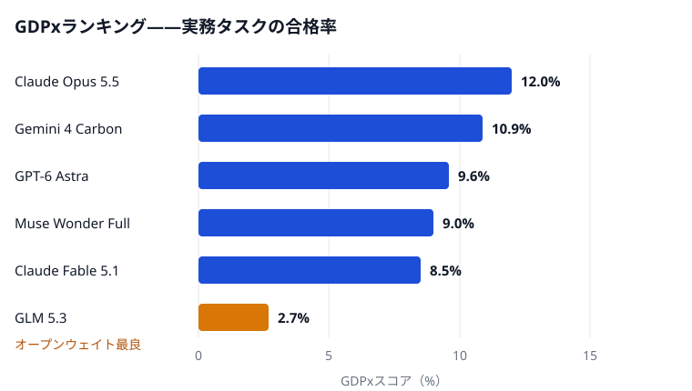

2026年11月2日、SemiAnalysisが[GDPx](https://gdpx.semianalysis.com)を公開した。AIに試験問題ではなく実務そのものを渡すベンチマークだ。買収の分析、契約の修正、チップ設計——最大8時間、採点は実務家の基準だ。世界最高スコアは12.0%だった。

## 答えではなく仕事を

GDPx v1.0は206件のタスクを11分野に配る。チップ設計、サイバーセキュリティ、生物学、金融、法務、クオンツ取引、再帰的自己改善、ハードウェア設計、材料科学、アライメント、ソフトウェア工学だ。タスクは14社が構築。試行は3回、スコアは初回合格率の平均。大半は二択採点、一部は連続スコアだ。前身GDPval（OpenAI、2025年）は文書しか採点しなかった。

## ランキング

<figure>

<figcaption>図1 — GDPx上位5モデルと、オープンウェイト最良のGLM 5.3のスコア。出典：SemiAnalysisのGDPxランキング。</figcaption>
</figure>

首位はClaude Opus 5.5の12.0%。8件に1件の完了だ。Gemini 4 Carbon 10.9%、GPT-6 Astra 9.6%、Muse Wonder Full 9.0%と続く。オープンウェイト最良のGLM 5.3は2.7%。金融と法務では、厳格な採点でほぼ全モデルが0点となり、部分点報告に切り替わった。

## お金では解決しない

Opus 5.5は1タスク平均51.41ドル。最貴のFable 5.1は67.16ドルでも8.5%と低い。DeepSeek 4.1 Flashは0.94ドル（Opusの約55分の1）で5.4%、最高の半分近くに達した。金で買える強さは、金額に比例しない。

[Quant-Arena](https://opensilabs.github.io/ja/2026-10-31-quant-arena)はクオンツ版の同じ物語だ。9モデルがA株の戦略を書いたが、市場全体の保有に勝てなかった。クオンツ取引は一分野で、Opus 5.5が首位を取ったが、採点済み実行の大半は単純な参照戦略に及ばなかった。再帰的自己改善も同表に載るが、習熟に近いモデルはない。

## 冷静に読むために

GDPxは物差しであり、新モデルでも手法でもない。しかも物差しには持ち主がいる——SemiAnalysisの有料製品だ。タスクの大半は非公開・無監査、再現はまだない。低さの一部は開発側の事情だ。OpusとAstraの安全分類器がサイバー、生物、アライメントで作業を拒み、平均を下げる。12%は206件の合格率にすぎず、全ての仕事の測定ではない。

GDPxが測るのは、何を仕上げられるかだ。初の本格測定で、最強の機械は8件中7件を未完に残した。この数字が伸びる速さこそ、今の議論だ。
