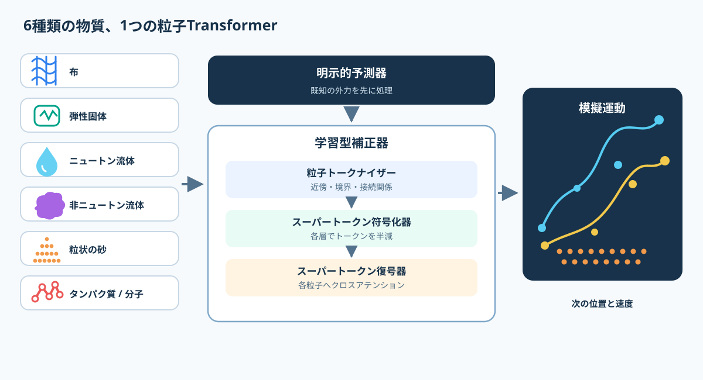

砂丘、シャツ、水しぶき、ゴム、タンパク質は別の計算問題に見える。WorldParticleは、どれも3次元粒子の集まりとして表し、Transformerに次の動きを一歩ずつ予測させる。MITとUBCなどの研究で、[論文](https://arxiv.org/abs/2605.15305)は2026年5月に公開。11月は誌面掲載と[MITの報道](https://news.mit.edu/2026/single-ai-model-simulates-many-substances-behavior-1109)の節目、12月にSIGGRAPH Asiaで発表予定で、新論文ではない。

## 対象ごとに別の道具だった

流体は格子、布と弾性体はメッシュ、砂は粒状体力学、タンパク質は原子ポテンシャルを使う。各分野に別の方程式と道具がある。WorldParticleは、固定格子ではなく物質と一緒に動く粒子で表すラグランジュ表現を共通言語にした。相互作用は学習で得る。

## 分かる力を先に、残りを学習

Chen氏は「ChatGPTに似るが、予測するのは単語ではなく粒子の動き」と言う。明示的予測器が重力などの既知の外力を先に適用し、衝突、圧力、摩擦、結合は学習型補正器が担う。粒子トークナイザーが近傍、境界、接続関係を見て、スーパートークン符号化器がトークンを段階的に統合し、各層で半減させる。復号器はクロスアテンションで各粒子の補正に戻す。約1億5700万パラメータの構造は6分野で固定し、訓練データだけを替える。

<figure>

<figcaption>図1 — 6種類の粒子ダイナミクスが1つの固定構造に入る。明示的予測器が既知の力を処理し、学習型補正器が粒子トークンとスーパートークンで相互作用を計算する。</figcaption>
</figure>

## 砂とタンパク質で見えたもの

既存ソルバーの軌跡で分野別に訓練し、未知の条件で試した。MITは6分野で数値シミュレーションより高精度とまとめる。訓練にない虎形の砂山は自然に崩れ、一部の神経型ベースラインは砂粒を空中に残した。タンパク質側鎖では50フェムト秒刻みを使い、従来対照は0.5フェムト秒だった。Guo氏は約100倍速いと言うが、数字はタンパク質限定だ。

## 統一は構造まで

共通の状態表現があれば、物質を結合し、試し、目標へ向けて係数を探しやすい。出力は映像ではなく、検査できる位置と速度だ。チームは物理の基盤モデルへの第一歩と呼ぶ。

ただし重みは分野ごとに別で、共有モデルは将来課題だ。専用ソルバーに単分野の精度で譲る点もある。学習元は既存ソルバーの軌跡なので、その前提と誤差も受け継ぐ。結果はチーム自身の測定で、独立再現はない。逐次予測の誤差蓄積も消えていない。

訓練データを替えるだけで新しい物質を学べるなら、物理を理解するとは何か。支配方程式を導くことか、設計に使えるほど正確に物質の次の動きを予測することか。
