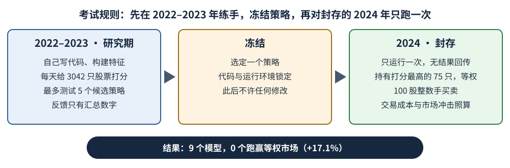
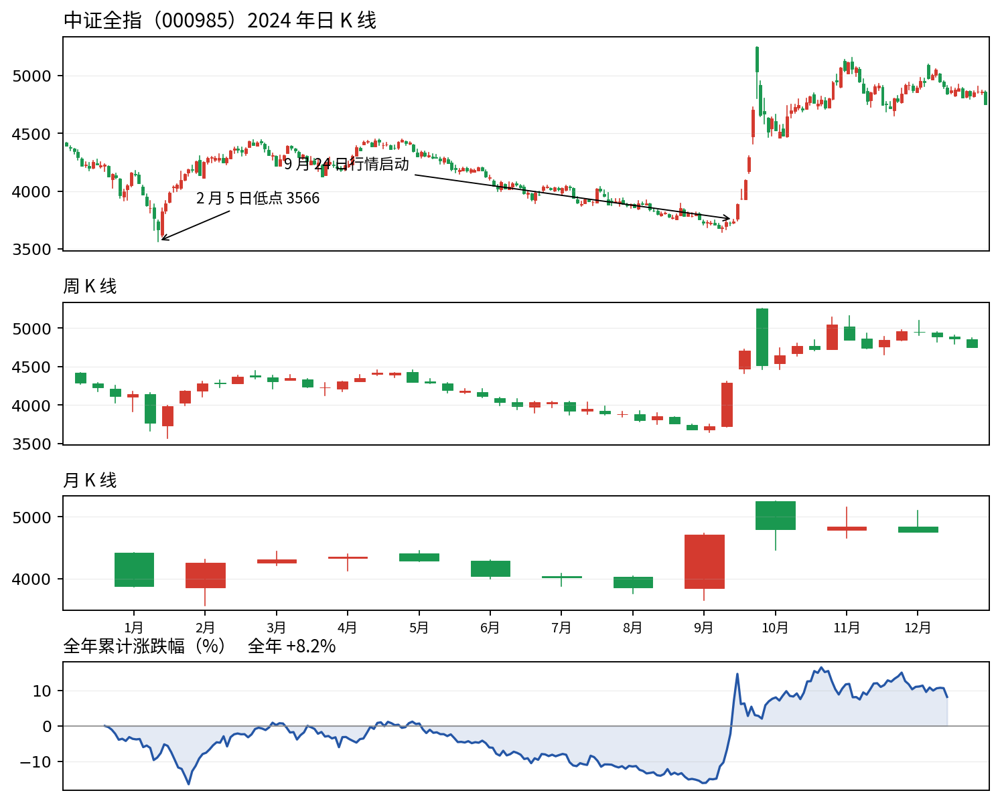
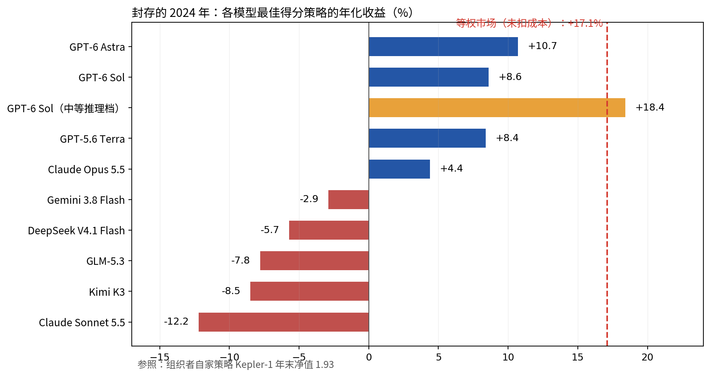

隔三差五就有新闻说，某个 AI 模型跑赢了股市。这类说法几乎都建立在"回测"上：把几年前的老价格喂给模型，看它当年"本来能"赚多少。问题在于，大语言模型读过历史。你给它看 2021 年的新闻，它未必在预测——它可能只是记得结局。

Navers Lab 和 Einsia.AI 的一个团队决定把这场考试正经考一次。他们的基准叫 Quant-Arena（Houde Qian 等 12 位作者，2026 年 10 月 21 日发表于 arXiv）：把 3042 只中国 A 股的原始数据交给模型，让它干完量化研究员的整套活——写代码、想信号、做测试、定下一个策略——然后面对一个它从没见过的年份，且没有改口的机会。九个当今最强的模型参加了考试。在封存的 2024 年里，没有一个跑赢最懒的组合：每只股票买一样多。

## 一场没法背答案的考试

每个模型拿到的是最原始的行情数据，细到 Level-2 的逐笔委托和成交。它要自己写 Python 代码，从数据里造出它认为有用的特征，再每天给 3042 只股票逐一打分。

研究期是 2022–2023 年。这两年里，每个模型最多只能测试 5 个候选策略，拿到的反馈也刻意给得很薄：只有汇总的收益和信号统计，永远看不到未来。最多试 5 个，这个上限很关键——在旧数据上试的策略足够多，总有一个会靠运气显得特别出色。

然后，一个策略被冻结：代码和运行环境全部锁定。2024 年只跑一次，结果不回传给模型。裁判是一个严格守规矩的现金账户：每天持有策略打分最高的 75 只股票，按 A 股标准以 100 股整数手买卖，收真实的交易成本，还要算"市场冲击"——就是你自己的买单会把价格往上推、卖单会把价格往下压，这个摩擦用模拟订单簿估算。账户里闲置的现金，收益是 0%。

<figure>

<figcaption>图 1 — Quant-Arena 的考试流程：两年研究期、最多五个候选策略，然后代码锁定，封存年份只跑一次。</figcaption>
</figure>

## 先说清：要跑赢的"市场"到底是什么

模型要跑赢的那个东西，得先解释，因为"市场"不是一个数字。

这场考试的标尺是等权组合：把钱平均分给 3042 只股票，每只买一样多。不选股、不判断，一家小县城的作坊和最大的国有银行分量完全相同。这是拥有一个市场最懒的方法，也正因如此，它是合适的标尺——它不需要任何智力。

大多数人熟悉的是另一种平均：沪深300、中证全指（指数代码 000985）这类指数按市值加权，公司越大，在指数里占的分量越大，大银行动一动指数就动，小股票几乎没存在感。同一个市场，两种"平均"可以差很多。2024 年差距就很大：论文的等权参照全年涨了 17.1%（这是没扣成本的毛收益），市值加权的中证全指只涨了 8.2%。等权给了小股票完整的投票权，而那一年恰好是小股票更强。模型们面对的这条及格线，不低。

下文还会反复出现一个词：净值。就是年初的 1 块钱到后来值多少。净值从 1.000 涨到 1.170，就是赚了 17.0%。

## 2024 年：崩盘、阴跌和政策行情

被封存的这一年并不温和。年初先是小盘股崩盘：2024 年 1 月到 2 月初，小股票剧烈下跌，中证全指 2 月 5 日盘中低点 3566 点。等权标尺因为构造上就给小股票全额权重，跌得更狠：到 2 月 6 日只剩 0.704——1 月 1 日投入的 1 块钱，只值 7 毛。

春天修复了一部分，然后是整个夏天的漫长阴跌。到 9 月下旬，中证全指还在年初的起点之下。接着，9 月 24 日一揽子政策出台，点燃了 A 股历史上最猛烈的反弹之一：从 9 月 23 日收盘到年底，指数涨了 27.1%，全年收涨 8.2%。等权参照走完更颠簸的一程，收在 1.170。

<figure>

<figcaption>图 2 — 中证全指（000985），市值加权，2024 年日 K、周 K、月 K 线与全年累计涨跌幅（真实数据，来源：腾讯行情历史数据）。A 股惯例：红涨绿跌。这个指数 2024 年涨了 8.2%——它和论文用的等权参照（+17.1%）是同一个市场的两个不同“平均数”。</figcaption>
</figure>

任何在 2023 年底被冻结的策略，都得依次扛过这三幕：崩盘、阴跌、暴涨。

## 成绩单：四个站在水面上，五个沉了

九个模型——GPT-6 Astra、GPT-6 Sol、GPT-5.6 Terra、Claude Opus 5.5、Claude Sonnet 5.5、Gemini 3.8 Flash、DeepSeek V4.1 Flash、Kimi K3、GLM-5.3——各自跑了几个不同的推理强度档位，合计 38 个带反馈迭代的配置（外加 38 个一次性的）。下面都是年化收益（测试只有一年，年化大致就是把这一年的涨跌折算成年率），已经扣掉账户实际付出的交易成本。

没有一个模型的最佳成绩跑赢 +17.1%。总分最高的是最高推理档的 GPT-6 Astra：+10.7%，落后市场 6.3 个百分点，但它的最大回撤只有 −6.8%（最大回撤是全程从最高点到其后最低点的最深跌幅，也就是账户最惨时陷进去的坑有多深）。随后是 Sol +8.6%、Terra +8.4%、Opus 5.5 +4.4%。其余五个都在亏钱：Gemini 3.8 Flash −2.9%、DeepSeek V4.1 Flash −5.7%、GLM-5.3 −7.8%、Kimi K3 −8.5%、Claude Sonnet 5.5 −12.2%。只有四个模型年底的钱比年初多，净值 1.11、1.09、1.08、1.04，其余在 0.88 到 0.97 之间。

38 个配置里只有 13 个赚到钱。真正跑赢市场的只有一个：中等推理档的 GPT-6 Sol，+18.4%。但这个胜利的代价要看清楚：它的最大回撤是 −35.9%——年中最惨的时候，账户里的 1 块钱只剩约 6 毛 4，然后才爬回来。只赢市场 1.3 个百分点，却要先坐一趟 36% 的深坑，这笔买卖多数人不会接受。

<figure>

<figcaption>图 3 — 每根柱子是该模型得分最高的那次运行在封存 2024 年的年化收益。金色的 GPT-6 Sol（中等推理档）是唯一跑到市场线上方的运行——代价是途中最大回撤 35.9%。模型收益已扣交易成本；等权市场线（+17.1%）是未扣成本的毛收益。</figcaption>
</figure>

## 为什么输：排名是真的，组合没跟上

论文自己的归因分析是最有意思的部分，因为这些模型并不是什么都不懂。它们能给股票排名——只是排出来的名次变不成钱。

先说 RankIC，这是衡量排名本事的分数：看模型给股票排的顺序，和这些股票接下来的真实表现顺序有多吻合。1.0 是完美预言排名，0 就是抛硬币。它是预测的成绩单，不是银行余额。而在 38 次运行里，RankIC 和实际收益的相关性是 0.09——基本等于没有关系。GLM-5.3 排名排得不错（RankIC 0.046），亏了 7.8%；Claude Opus 5.5 在中等推理档下排名约等于瞎猜（−0.002），反而赚了 4.4%。

更麻烦的是，排名在最顶端还拐了弯。把模型排出的股票分成十组来看，九个模型里有六个呈现"驼峰"：第二、第三组赚得最多，每天 24 到 33 个基点（一个基点是 0.01%），而第一组——模型最最看好的股票、也是组合真正买入的那批——赚得更少。信号是真的，但很微弱，而且恰好在钱真正押下去的位置衰减了。

还有仓位。大多数策略只把不到一半的钱放在股市里：38 次运行中有 35 次，平均仓位在 34% 到 48% 之间。闲置现金收益为零，一个只投了四成仓位的策略，面对一个涨了 17% 的市场，在选股开始之前就先让出了大半涨幅，却还要为每一次调仓付交易成本。另外两个规律补全了图景。推理强度更高并不稳定地更好：九个模型里有六个，最佳档位不是最高档。带反馈的迭代把每个模型的总分都提高了，却只提高了其中四个的实际收益——反馈教会模型的一部分东西，是 2022–2023 这两年特有的脾气。用行话说叫过拟合：把历史的偶然越拟合越紧，策略就成了背排练稿，上了台就演砸。最后，它们的风格还高度趋同：九个里八个偏向小盘股，七个偏向价值（相对账面价值便宜的股票），多数偏向低波动。大家捧着同一本教科书，自然谁也甩不开谁。

## 冠军是靠“躲”出来的

总分冠军值得单独看，因为 Astra 赢的方式就是整个故事的缩影。

Astra 的早期候选在两个研究年份都在亏钱：2022 年 −12.2%，2023 年 −13.6%。到第四、第五个候选时，它给自己加了一个"市场状态开关"：每天检查整个股票池，只有当所有股票的中位数在过去 5 天和 20 天的收益都为正时才持有股票，否则全部持有现金。规则很简单：只在整个市场都在涨的时候下场。

在封存的 2024 年，这个开关比任何选股都值钱。等权市场在 2 月 6 日跌到 0.704 时，Astra 的账户净值纹丝不动，还是恰好 1.000——它根本什么都没买。它 2 月 28 日才第一次买入。整个 1–2 月，它的最大回撤是 −1.7%，市场是 −29.6%。

但安全是有价的。Astra 有 75% 的交易日持有现金。从 2 月低点开始的那波反弹，它只吃到 16%（一直满仓参与的 Terra 吃到了 73%）。它全年收益的 12.5%，是在 9 月 24 日到 30 日短短五个交易日里赚到的——那几天它恰好在场，赶上了政策行情。最终它收在净值 1.107，市场是 1.170：大半年躲在场外，靠一周的好运把成绩拉回体面。这是风控，确实有价值——但这不是选股的天才。

## 出题人自己的策略说明了什么

同一张排行榜上还有一行，必须如实交代：Kepler-1，Einsia.AI 的自有策略——就是出题团队自己的。总分 77.56，最佳模型是 51.29；2024 年收在净值 1.93，市场是 1.17。先说披露：这是主办方自己的条目，那一行的作业等于是自己给自己改。但它的账户同样由同一个裁判按同一套规则计算，这一点是实的。更要紧的是：它的 RankIC 是 0.085，比 Astra 的 0.101 还低，而它的夏普比率（每承担一份颠簸换来多少收益）是 2.98，最佳模型只有 1.89。

Kepler-1 说明两件事。第一，这场考试是可以考过的，模型们失败不是因为及格线定得不可能。第二，差距不在预测：Kepler-1 的排名比 Astra 还略差，赚的钱却多得多。差的是把信号变成组合的手艺——押多少仓位、保持多满的仓位、怎么压成本。这套不起眼的机器活，恰恰是模型们最弱的地方。

## 为什么“封存”两个字是关键

有人会问，这套封存设计是不是小题大做。2026 年 8 月 Artul.ai 研究组的一项研究给出了答案。那支团队让语言模型给 165,182 份财报电话会记录打分，测试了约 1600 个假设。它选出的最佳信号通过了他们能想到的全部回测检验——对半验证、安慰剂问题、预注册，全过了。然后他们把信号冻结，往前看了 12 个月：相对指数的中位数收益是 −12.4%。解剖发现了原因：只给模型股票代码和日期，连一份文件都不给，它仍然能"预测"对 66% 到 72% 的历史赢家。它认出了那段时期，记住了结局。在公开历史数据上做回测，就是一场模型可能握着答案的考试。

Quant-Arena 的防御正好一条对一条：封存年份让它无从背起；候选最多 5 个，让它买不了成百上千张彩票；交易成本必须打开，因为纸面利润到了真实执行里常常蒸发。

## 保留意见与结论

保留意见说全：这是预印本，未经同行评审。只测了一个封存年份、一个市场，而 2024 年的形状很特殊——先崩盘、再政策暴涨——换一年，模型排名未必如此。+17.1% 的市场线是毛收益，策略却要付成本，这条线对模型略有不利；真做一个等权组合，净收益会低于 17.1%。每个配置只跑了一次，运气没有被平均掉。总分里有一部分用了未公开的公式。Kepler-1 是主办方自己的策略，已经交代过了。

这些保留推翻不了核心结论，因为结论本身很克制，而这套设计是迄今为止用在这个题目上最干净的。这是第一次有一个公开的、像样的测试，问的不是"模型会不会聊股票"，而是它能不能干完量化研究员的整条链路：想法、代码、测试、冻结，然后在没见过的数据里活下来。目前的答案是：当今最强的模型能找到微弱而真实的信号，却还不能把信号变成跑赢"每只买一样多"的组合。成绩最好的那个，是靠四分之三的时间拒绝下场赢的。瓶颈不在预测，在预测之后的一切。

所以下次再看到"我们的 AI 收益 X%"的宣传，问一个问题就够了：策略是在测试期开始之前冻结的吗？那段时间是封存的吗？如果不是，你看到的不是证据，是广告。
