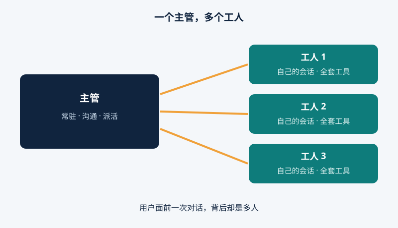
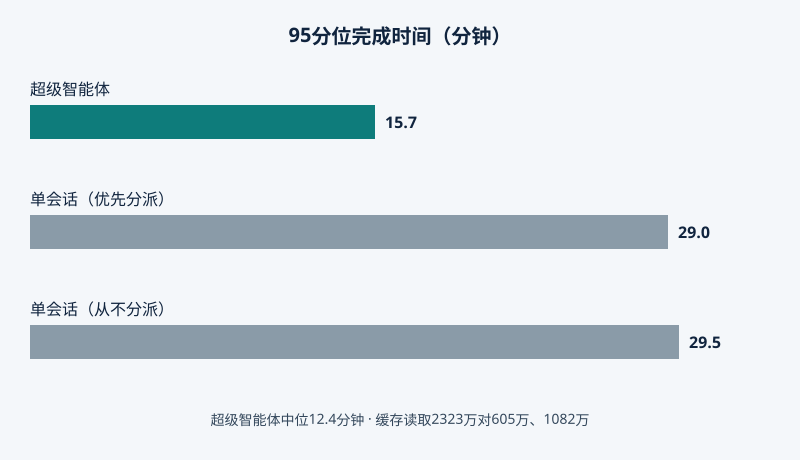

2026年10月31日，DeepSeek Harness团队发表超级智能体设计文章，并开源MIT原型dsh-superagent-prototype：AI编程的下一个瓶颈不是模型，而是人，一个人通常只能跟住三到五个会话。

## 前台主管，后台工人

设计分两层：Router主管常驻，接收各渠道请求，只沟通派活，轻量模型就够；Worker工人各有上下文和目录，配齐全套工具、通常用最强模型。工人干完经主管回复用户。

<figure>

<figcaption>图 1 — 主管沟通派活；每个工人只管一项任务，自带会话和目录，经主管汇报。</figcaption>
</figure>

## 先听，再说

超级智能体由事件驱动：聊天、日程、评审、测试结果。事件过两道筛选：Fast Path按来源、群组、白名单放行，Slow Path按策略复核。同请求或话题的事件组成Thread，工人认领后订阅，后续消息直达工人。

记忆也省着用：上下文如缓存，可能信息直接inline，其余截断留指针，对象带关联ID。更主动的是静默修复：内部版本默默复现修复bug，确认问题并找到简单修复后才出声。

## 数字要老实标

测试用合成数据流：约300条消息、约20个请求，每种配置跑5次；写代码被耗时工具替代，时间缩放到四分之一，测调度而非代码质量，结果只是初步参考。

<figure>

<figcaption>图 2 — 合成负载下，超级智能体95%任务15.7分钟内完成，单会话方案为29.0和29.5分钟；代价是缓存读取2323万对605万和1082万token。</figcaption>
</figure>

一半任务12.4分钟、95%在15.7分钟内完成，单会话95分位29.5分钟；优先分派的单会话也有29.0分钟——有一次它判某任务“很小”便自己动手，结果卡住。代价是缓存读取2323万token，远高于605万、1082万。

## 发布了什么，又要当心什么

公开原型面向单个GitHub仓库，是DeepSeek Harness的bundle，监听GitHub、可选飞书；获准请求成为工作项，自带会话和目录，结果回到原对话，如拉取请求。但README写明：这只是参考用的研究代码，不是正式产品、未达生产就绪；与内部版本不同，部分设计未实现。

安全警告：据报道工人无需批准即可作为操作系统用户运行命令，而Harness还是实验性预览软件，务必检查插件和命令、最小权限运行。

## 为什么重要

10月31日没有新模型，而这正是关键：下一步收益来自组织——把人的注意力当作稀缺资源，只花在决策上。付费工具卖模型加聊天窗口，DeepSeek却免费公开了把任何模型变成团队的模式。只是，默默修bug固然美好，直到它默默做了你不会批准的事——白名单、筛选和人工面板够不够，每个安装团队必须自己回答。

如果编程智能体能在你察觉前悄悄修好bug，你愿意放手让它不请示地做到哪一步？
