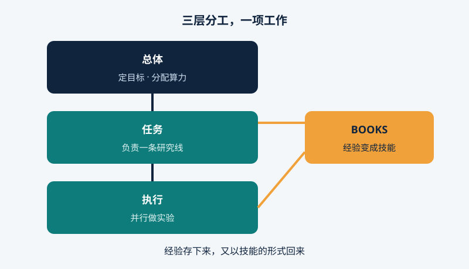
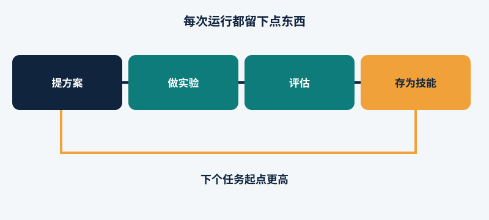

2026年11月2日，腾讯混元团队发布研究智能体 Hyra 2.0。多数研究智能体像临时工：接题、做实验、交答案，然后全部忘光；Hyra 2.0 则要留下点东西——模型、工作流或工具，让下一项任务从更高的起点开始。

## 三层分工，和一本不会忘的账

Hyra 2.0 分三层：总体（Overall）定目标、分配算力；任务（Mission）各负责一条研究线，随结果修正计划；执行（Worker）在沙箱里并行做实验、写代码、打分。

关键不在分层，而在什么能活过任务结束：经验存进叫 Books 的共享知识库，有用的转成技能，失败的路也被记下。7月的 Hyra 1.0 已是“提方案—做实验—再修正”的循环，2.0 加了长程统筹，项目可跑数天乃至数周。

<figure>

<figcaption>图 1 — 总体定目标，任务智能体负责研究线，执行智能体并行实验，经验存入 Books 转回为技能。</figcaption>
</figure>

## 它真正拿出了什么

腾讯给出了可查的成果，权重、代码和技术报告都在 Hyra-results 仓库里。蛋白质方向，HyInv 是“逆折叠”模型：给定形状，反推能折成它的氨基酸序列。它只有 196 万参数，腾讯称速度约为 ProteinMPNN 的 57 倍；HyPLM-Flash 为 6.5 亿参数，单张 H20 上约每秒推理 13 万个残基；另有五个 HyFF 力场。

它还走得更远：HyQEC 构造了 [488, 123, 22] 量子码，腾讯称编码效率比 qLDPC 挑战赛此前纪录高约 48%；数学上给出了 Yu 七维流形圆作用假设的反例，并证明了五维 Petty 假设；芯片上把开源 XiangShan 处理器的 SPEC CPU2006 每 GHz 分数提高了 5.79%。

<figure>

<figcaption>图 2 — 提方案、做实验、评估、存为技能，下个任务起点更高。</figcaption>
</figure>

## 必须说清的保留

这些数字都来自腾讯。快不等于好：公开资料没有 HyInv 的精度指标，“57 倍”不能读成“好 57 倍”。数学成果未见同行评审，形式化证明情况也不清楚。智能体本身并不开源，编排代码、提示词和人工干预记录都未公开，还有评述指出 Hyra 2.0 的成果是宣布后续放进仓库，而非今天全部可下载。外界能核查的是成果而非过程；它也没有公开 API。

## 为什么这仍然重要

新鲜的角度不在单件成果，而在积累改变了研究的经济学：一次性智能体把算力变成答案，花完就没了；会积累的智能体把算力变成资本。评价方式也得变：审计它积累了什么、能迁移多少。

但积累是双刃剑：会记住经验的系统也会记住错误。有缺陷的评估器一旦存为技能，会在每个任务里悄悄给坏结果放行；错的经验复用上百次，扩散得更快。Hyra 1.0 自己就曾找到“骗过”评估器的办法。所以真正的瓶颈可能不是智能体多聪明，而是“裁判”够不够好——谁来决定哪些经验值得留下。

还有一层循环：腾讯称 Hyra 2.0 已在参与下一代混元模型的训练与推理优化，在帮助建造未来驱动 Hyra 自身的模型——会造工具的智能体帮助建造自己的继任者，正是递归自我改进的形状。这条循环是提效还是更难驾驭，同样取决于裁判。

如果你的 AI 每次实验都给下一次留下一件工具，你最希望它留下哪个答案，又最怕它记错哪条经验？

Sources: https://hy.tencent.com/research/hyra2 , https://github.com/Tencent-Hunyuan/Hyra-results , https://www.mlllm.io/articles/3691-tencent-hunyuan-releases-hyra-2-0-a-research-agent-that-accumulates-models-and-skills/ , https://alphasignal.ai/news/tencent-s-hyra-2-0-builds-reusable-ai-tools-that-get-smarter-over-time
