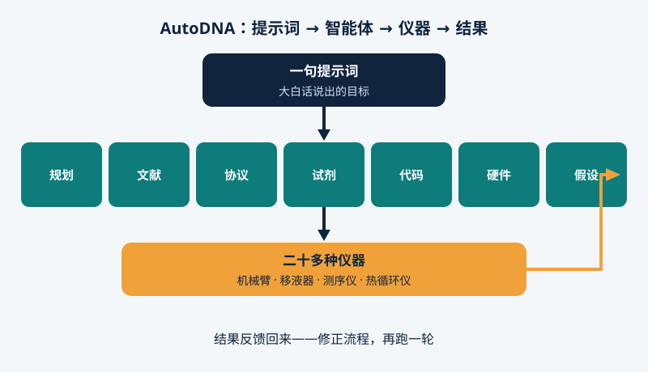

2026年11月4日，《自然》[发表了上海交大团队的 AutoDNA](https://www.nature.com/articles/s41586-026-11228-6)：人只给一句大白话目标，AI 智能体团队自己设计实验、写代码、调度二十多种设备、看结果、出错自己改，人手只剩下[补试剂、换耗材](https://www.nature.com/articles/d41586-026-03552-8)。

## 围着智能体建的实验室

实验室自动化不新鲜，但以前自动的是手：移液、加热、搬板子，动脑子的还是人。陈海波说，现有系统多数仍要专家逐台配置仪器，AI 只管一小段。吴明宇等人做的 AutoDNA 做法相反：模型、实验、仪器从一开始就一起设计，智能体能同时顾及目标与硬件。

## 七个智能体，二十多种仪器

七个智能体分工：规划拆步骤，文献查已知，协议写流程，试剂核物料，代码写程序，硬件排期、忙时换设备，假设提改进。设计、实验、优化，循环往复。

实体一侧是机械臂、移液器、热循环仪、磁力架、纳米孔测序仪等二十多种仪器。

<figure>

<figcaption>图 1 — 一句提示词、七个分工智能体、二十多种仪器，结果反馈回来修正流程。</figcaption>
</figure>

## 三个可以核查的结果

**一句话存进 DNA。** "Intelligence is the ability to adapt to change"被编码进 DNA：设计编码、合成 78 条链、存储、扩增、测序读回、解码，跑了 11,000 多次仪器操作、约 200 小时，原文一字不差恢复。

**自己试出专家水平。** 酶促 DNA 合成里，智能体反复调反应时间、浓度、洗涤步骤，逐步产率做到 97.8%，追平已发表的专家优化结果；多协议并发比顺序快 3.2 倍。

**查出已知的癌症突变。** 给一份预处理结直肠癌样本，它自设并合成引物，检出样本已知的 KRAS G13D 突变。

一个小细节：检测中它自己决定孵育时给反应管盖盖防蒸发，没人交代过。老手下意识会做、新手常漏掉的一步。

## 真正被自动化的，是判断

移液从来不是难点。实验室稀缺的是专家的判断：怎么设计流程、结果不对劲时怎么看出来、下一步试什么。AutoDNA 自动化的正是这一层。若走出这一间实验室，实验就不再只是专家团队的专利，而更像大白话点单的服务，作者称为"科学即服务"的蓝图。

## 保留要说清

这些都是受控的验证任务，不是新发现：突变本就已知；存一句话只证明流程跑得通，不等于能当档案库。人还要补试剂、换耗材、修设备，故障有时仍要人上手。系统只有这一间，只做核酸化学。预印本 2025 年 7 月已公开（arXiv:2507.02379），本周的新节点是通过《自然》同行评审。代码与数据开源在 GitHub 和 Zenodo，供他人验证。

当机器既能设计又能执行实验，非人不可的还剩什么——提出问题，还是看出答案错了？
