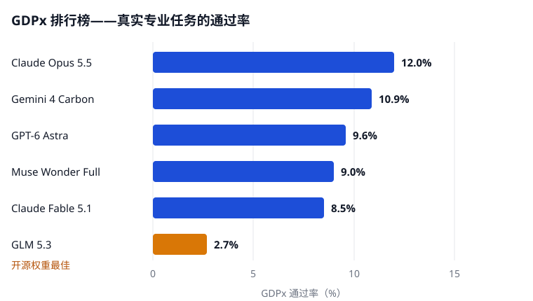

11月2日，SemiAnalysis 发布 [GDPx](https://gdpx.semianalysis.com)。它不考问答，直接把真实工作交给 AI：一桩并购要分析、一份合同要修订、一颗芯片要设计，每项最长 8 小时，按从业者标准判分。全球最高分：12.0%。

## 交活，不是答题

GDPx v1.0 有 206 项任务，11 个等权领域：芯片设计、网络安全、生物、金融、法律、量化交易、递归自我改进、硬件设计、材料科学、对齐、软件工程。14 家专业机构建任务。每项试 3 次，按首次通过率平均；多为过与不过，少数按完成度给分。

它接 OpenAI 2025 年的 GDPval——只看文档，不让模型动手。作者认为，真实工作是打开文件、用工具、花几小时改回自己的错，不是一次写出漂亮答案。

## 排行榜

<figure>

<figcaption>图 1 — GDPx 前五名的分数，外加开源权重最佳的 GLM 5.3。数据来源：SemiAnalysis 的 GDPx 排行榜。</figcaption>
</figure>

Claude Opus 5.5 第一，12.0%——约每 8 项成 1 项；Gemini 4 Carbon 10.9%、GPT-6 Astra 9.6%、Muse Wonder Full 9.0% 分列二到四名。开源最好的 GLM 5.3 只有 2.7%。金融、法律更干脆：严格判分几乎全是 0 分，只好改报部分分——公开任务里 20 次尝试没一次交出能用的修订稿。

## 钱买不到等比例的分数

Opus 5.5 每项平均 51.41 美元；最贵的 Fable 5.1 每项 67.16 美元，分数反而只有 8.5%。DeepSeek 4.1 Flash 每项 0.94 美元——约 Opus 的五十五分之一——也拿到 5.4%，近最高分一半。花钱买得到更强，买不到等比例的更强。

[Quant-Arena](https://opensilabs.github.io/zh/2026-10-31-quant-arena)是量化版的同一故事：9 个前沿模型为 3042 只 A 股写策略，没一个跑赢持有市场。量化交易正是其领域之一，Opus 5.5 拿了第一；但据 SemiAnalysis，多数已判分的量化运行仍跑输简单参考策略。递归自我改进也在榜——行业赌 AI 能加速自身研发——没模型接近拿下它或合同法务。

## 保留要说清

GDPx 是尺子，不是新模型新方法，而尺子有主人：付费产品，任务多不公开、无外部审计、无外部复现。低分有一部分源于实验室自己：Opus 5.5 与 GPT-6 Astra 的安全分类器会拒答或收紧网络安全、生物、对齐三领域的输出，官方另有剔除三领域的排名。还要防误读：12% 只是这 206 项的通过率，不是所有工作的测量；金融、法律全 0 分，也说明真实交付物有多不留情。

行业过去量的是知道什么；GDPx 量的是能做完什么。第一次认真测量，最强的机器 8 项工作有 7 项没做完。这数字涨多快，才是要紧的争论。
