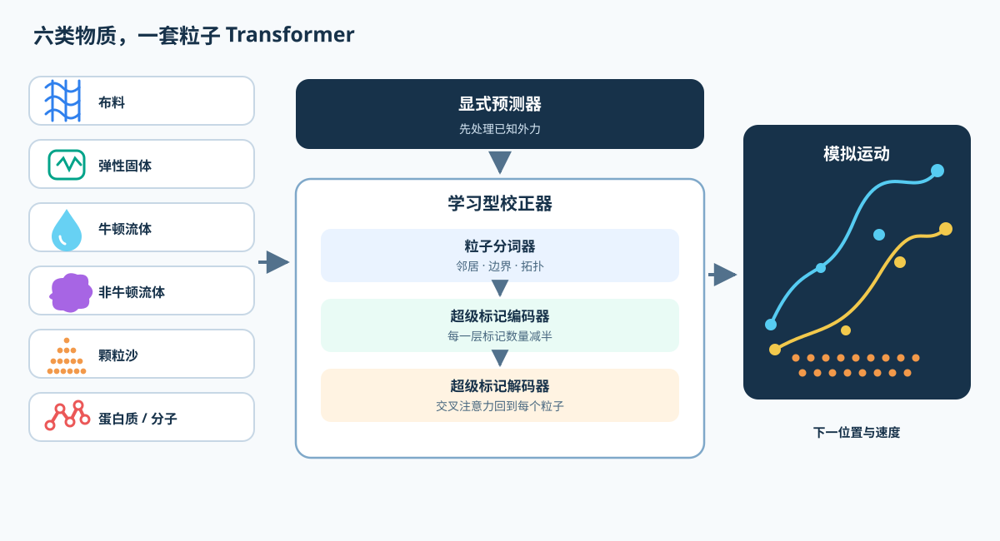

沙丘、衬衫、水花、橡胶块和蛋白质，看起来不是同一种计算问题。WorldParticle 却把它们拆成数千到数百万个三维粒子；粒子带位置、速度和材料属性，由一个 Transformer 一步步预测运动。

这是 MIT、英属哥伦比亚大学等机构的研究工作。[论文](https://arxiv.org/abs/2605.15305)2026 年 5 月已上 arXiv；11 月节点是期刊发表和 [MIT 报道](https://news.mit.edu/2026/single-ai-model-simulates-many-substances-behavior-1109)，12 月将在 SIGGRAPH Asia 报告，并非 11 月新论文。

## 传统仿真是一块拼布

流体用网格或光滑粒子，布料和弹性体用网格与有限元，沙要颗粒力学，蛋白质要原子势能。各有方程、近似和软件，两种物质耦合时更难。

WorldParticle 用拉格朗日表示统一语言：不守着固定空间格点，而跟随物质移动。网格顶点、流体采样点、原子都写成粒子；粒子间作用则由学习得到。

## 先算已知外力，再学相互作用

Chen 说，它像 ChatGPT，只是预测的不是词，而是粒子下一步。显式预测器先按重力等已知外力推进，得到临时状态，却算不出碰撞、压力、摩擦与连接。

校正器分三段：粒子分词器看邻近粒子、边界接触和拓扑连接；超级标记编码器逐层合并标记、每层减半，让局部与远距作用交换信息；解码器用交叉注意力返回每个粒子的位置、速度修正。约 1.57 亿参数的架构六类固定，只换训练数据。

<figure>

<figcaption>图 1 — 六类粒子动力学进入同一固定架构：显式预测器处理已知外力，学习型校正器用粒子标记和超级标记计算相互作用。</figcaption>
</figure>

## 沙能落下，蛋白质步长放大百倍

团队按类别用成熟求解器轨迹分别训练，测试时换材料、形状、边界、初始状态和外力。MIT 概括称六类精度均高于数值模拟。没见过的虎形沙堆能合理坍塌、摊开，一些神经基线却让沙粒悬空。

蛋白质侧链预测用 50 飞秒步长，传统对照为 0.5 飞秒，Guo 称建模快约 100 倍；这只属于蛋白质。它还演示了交互施力、反求摩擦系数和从真实操作数据学习。

## 统一的是架构，还不是一个权重

共用状态接口后，不同物质更容易耦合、试错和反推参数。输出是可检查的位置与速度，不是只求像的画面。团队称之为物理基础模型的第一步。

但每类仍单独训练参数，共享权重尚待完成；单项精度也对专用经典求解器有损失。它学既有求解器轨迹，会继承假设和误差；结果未经独立复现。逐步预测会累积误差，预测—校正只是缓解。当前实现单张 80GB A100 约支持 5 万粒子。

若只换训练数据就能学会新物质，理解物理是推导方程，还是把下一步预测得准到能做设计？
